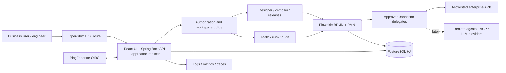

# Architecture
Status: proposed architecture; no runtime or benchmark validation yet.

## System shape

Use a modular Spring Boot application with embedded Flowable BPMN and DMN. Package the compiled React UI in the same application image initially. PostgreSQL holds application metadata, engine state, sessions and persisted events. CMMN is a later module for adaptive cases; do not invent a competing case engine.

Diagram includes target deployment dependencies; OpenShift, PingFederate and external services are not supplied by this repository.

## Module boundaries

| Module | Owns | Does not own |
|---|---|---|
| identity-policy | OIDC, membership, resource and action authorization | Workflow routing semantics |
| workflow-catalog | Draft revisions, folders, tags, immutable releases | Runtime token movement |
| compiler | Typed canonical model, validation, BPMN/DMN generation, source maps | Execution scheduling |
| runtime-facade | Start/query/cancel/task operations, engine-to-app mapping | Custom engine implementation |
| business-forms | Form schemas and server validation | Arbitrary user HTML/scripts |
| decisions | Decision table authoring, tests and locked artifacts | Arbitrary code evaluation |
| integrations | Connection versions, HTTP delegate, policies, effect journal | Storing credentials in workflows |
| audit-observability | Append-only business audit, event feed, correlation | Claiming logs are a transaction ledger |
| migration | Safe parsers, mapping reports, draft conversion | Automatic unsupported behavior guesses |
| ai-agents-mcp | Draft generation and constrained external invocation, later | Authority to publish or grant access |

Proposed repository: frontend/, backend/, contracts/, examples/, deploy/compose/, deploy/openshift/, tests/e2e/, docs/. Java packages follow modules and communicate through public application services. Use the same image for an optional separate worker deployment later, with API/job profiles; this changes scaling, not execution semantics.

## Canonical definition and compiler

Business JSON is the source for the supported business-editor subset. Compilation creates immutable BPMN, DMN, form schemas, dependency manifest and source map. Flowable executes those artifacts. It is never replaced by a custom graph runner.

Advanced imported BPMN is retained as its own source artifact. If it lies outside the supported canonical subset, v0 blocks deployment and reports why. Later an advanced BPMN mode may preserve broader semantics, but switching to business mode must be an explicit validated conversion. Do not continuously round-trip two independently editable authoritative models.

Compiler checks shape, unique IDs, supported types, graph reachability, default branches, typed mappings, permitted connector operations, form/rule versions and workspace access. v0 disallows cycles and unmatched parallel graphs. It generates only approved delegates and controlled expressions. Uploaded XML cannot specify arbitrary Java classes, beans, listeners, scripts or expressions.

## Persistence and transaction boundaries

Use one PostgreSQL database and a shared Spring transaction manager for application writes and embedded engine operations. Separate application and engine tables by schema where the tested engine configuration supports it. Engine schemas stay vendor-managed; application metadata uses Flyway.

Starting a run atomically inserts its idempotency record and run mapping, starts the exact processDefinitionId and commits accepted state. A failed transaction must not leave an accepted run response. All downstream external calls cross an async boundary.

Completing a task atomically checks ownership and workspace, validates the pinned form, appends the decision audit and completes the Flowable task. Concurrent completions return a conflict to the loser. Do not make network calls inside this user-facing transaction.

Application run summaries are projections for search and UX. Engine state is authoritative for progression. Persist event IDs and reconcile projections through engine APIs. If an audit write required for a sensitive command fails, the command fails as a unit.

## External effects and retry

Delivery to remote systems is at least once unless the remote contract provides stronger guarantees. A database transaction cannot atomically commit an unrelated HTTP API side effect.

For each service-task occurrence derive a stable effect key from workspace, run, activity ID and occurrence ID. Retries reuse that key; loops/multi-instance iterations in later releases receive distinct occurrence IDs.

Maintain an effect journal with a unique key, request hash, state (prepared/inFlight/succeeded/unknown/failed), attempts and a redacted result. Journal writes around an HTTP call require explicit independent transactions; a rollback of the engine transaction must not erase evidence of a remote success. Acquire journal ownership using a database lease.

Send the key to APIs that support deduplication. If the delegate crashes after remote success, recovery reads the journal or queries the remote system. A timeout without conclusive response becomes unknown, not automatically safe-to-retry. For a non-idempotent endpoint lacking reconciliation, block automatic retry and require operator review.

Choose bounded connection/read timeouts and a limited retry schedule. Classify transient transport/429/5xx separately from permanent validation/permission errors. The engine owns continuation and retry scheduling; the journal only records effects and deduplication. Do not implement a second execution scheduler.

## Multi-pod behavior

Flowable persists async/timer jobs and uses lock ownership and expiry during acquisition. Its documentation also states that tenant identifiers do not themselves enforce access. The application must apply authorization around engine access. [Flowable advanced documentation](https://www.flowable.com/open-source/docs/bpmn/ch18-Advanced/)

Our deployment design requires:
- A unique job owner per pod; shared PostgreSQL and bounded worker queues.
- Graceful termination that stops job acquisition before draining work.
- Leases longer than the maximum bounded task execution, with recovery tests after forced termination.
- A starting candidate of a 60-second job lease, 15-second expired-job scan and HTTP work budget below 30 seconds; confirm actual property names and effective behavior for the pinned release. Tune from tests.
- No pod-local scheduler for business events; no per-pod duplicate webhook handling.
- Polling or SSE that reads a durable event feed. Cross-pod reconnect uses event IDs.
- PostgreSQL-backed browser sessions, so requests do not require sticky routing or Redis.

Initial capacity hypothesis: 2 app pods, each 0.5 CPU/1 GiB request and 2 CPU/2 GiB limit; maximum 15 database connections per pod. Validate rather than present these as sizing results. If database max connections is 100, reserve 20 for operations and migrations: five pods at 15 use 75 of the 80 remaining connections. HPA ceilings must respect database and external rate limits.

## Identity and authorization

Use Spring Security OIDC login against PingFederate. Same-origin UI uses a Secure, HttpOnly, SameSite session cookie, CSRF protection and JDBC-backed sessions; access tokens are not stored in browser localStorage. Service APIs use separately configured resource-server token validation with issuer/audience checks.

Map immutable IdP subject and configured AD group claims to application memberships. Store manual role grants with audit. Every object is authorized by workspace and resource, not merely by a token's global role. Flowable tenantId maps to workspace, but all engine lookups/commands additionally verify the application ownership mapping.

Background execution uses an explicit workspace service identity with bounded connector/tool permissions, not a user's expired browser token or a thread-local security context. Recheck current policy at dispatch, so revocation takes effect even for a running workflow. Record initiating user separately.

Require permission both to use a connection at publish and to execute its operation at runtime. Approvers can act only on eligible tasks. Publishers cannot silently grant new tool rights. Protect audit, raw variable inspection, exports, logs and SSE with the same boundaries.

## Security controls

- No public generic Flowable REST endpoints and no user-uploaded delegates.
- Validate JSON size/depth/types; XML parsing disables external entities/DTDs and external schema fetching.
- Limit archive entry counts, expanded sizes and compression ratios; reject path traversal.
- Connection registry controls scheme, host, port and allowed operation paths. Egress policy/proxy prevents access to metadata, loopback/link-local and unauthorized internal services; approved private enterprise endpoints require explicit allowlisting.
- Validate DNS resolution and redirects at connection time; avoid naive string-only URL filtering.
- Credential references resolve only in backend execution through mounted secrets or approved secret manager. Export contains logical connection names.
- Redact secrets and sensitive payloads in logs, audit, history views and AI inputs; define retention with the data owner.
- Quotas cover runs, concurrent external calls, upload size and AI spend. Rate limits must work across replicas, using the ingress/platform or database-backed policy where needed.
- AI and MCP content is untrusted data. It cannot change authorization, allowed tools or execution policy.

## Versioning and promotion

Release binds canonical hash, compiler version, exact process/decision artifacts, form versions and dependency locks. Start uses explicit processDefinitionId rather than latest-by-key. Child workflows later bind exact process versions; independent latest child deployment must not alter a published parent's behavior.

Rollback selects a previously published version for new starts. Running instances remain on their original version. Active-instance migration requires its own validated procedure later.

Portable exports contain canonical source, generated artifacts, source maps and logical dependency names. Environment bindings supply concrete endpoints and credential references. Git export starts as files; automated repository push and promotion can follow without changing the model.

## OpenShift and operations

Container must tolerate an arbitrary non-root UID, use an unprivileged port, read-only root filesystem where possible and a writable temporary mount. Supply Route/TLS, Service, Deployment, ConfigMap, secret references, NetworkPolicy, resources, service account, probes and optional PDB/HPA in the build.

Readiness checks startup and ability to serve; liveness must not trigger restart storms for a temporary database outage. Restrict management endpoints. SIGTERM drains requests and jobs within the configured termination grace period.

Run schema migration once as a controlled predeployment job. Do not let every replica auto-upgrade engine tables. Rehearse vendor engine schema upgrades against a restored database. Use additive application migrations for safe rolling releases; destructive changes need a separate rollout.

Instrument API latency, failed logins, denied access, job age, retry/dead-letter count, connector timeouts, database pool usage and task lateness. Correlate request ID, run ID and node ID across logs/traces without payload secrets. Test database restore and record measured RPO/RTO before production approval.
