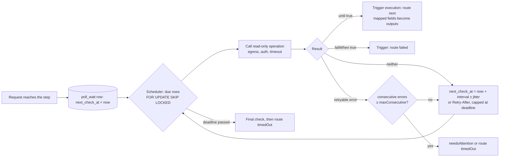
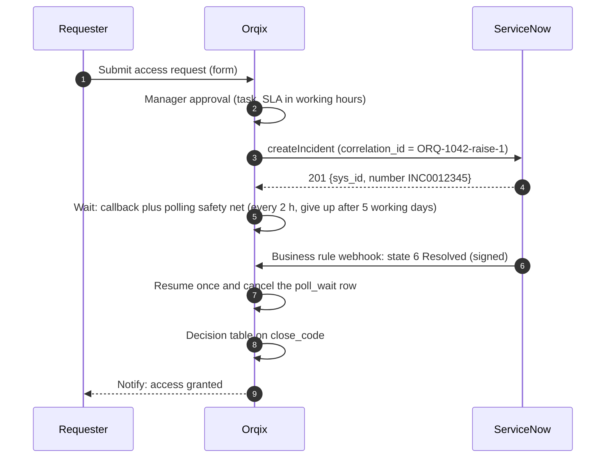
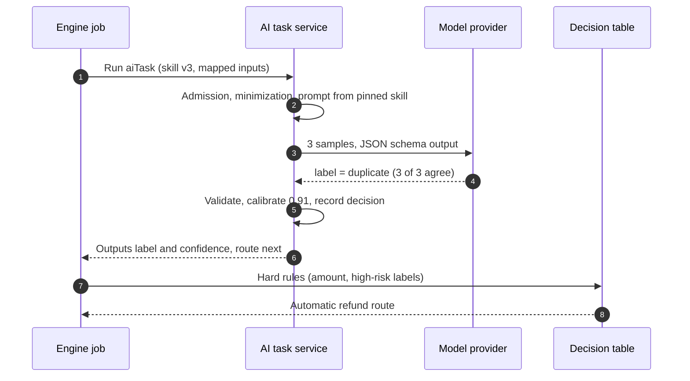
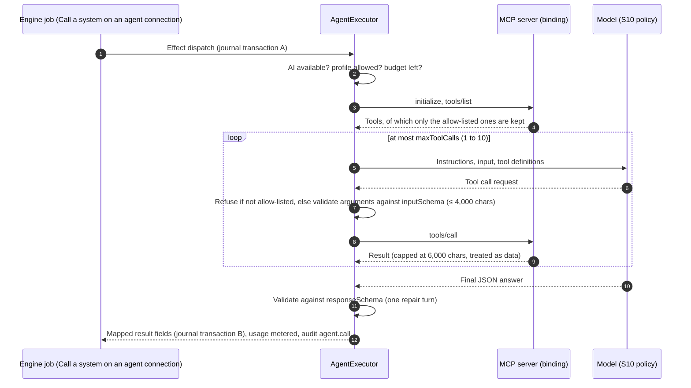

# Camunda feature gaps, Camunda drawbacks and the implementation plan
Revision 0.1 · 5 November 2026 · **Research and proposed design. Nothing in this document is implemented yet.** It compares Orqix with Camunda 7 and Camunda 8 up to 8.10 (released 13 October 2026) and specifies, at implementation level, how to close the gaps that matter.

This document builds on [20 Competitive analysis](20-competitive-analysis.md) and the [competitive gap delivery register](22-competitive-gap-delivery.md). Where those documents describe something as built, this document trusts them and the code; it does not re-verify their tests. New ticket identifiers use the prefix `CG-` so they do not collide with existing register IDs.

## How to read this document

| Need | Read |
|---|---|
| The conclusions and the decisions needed | [§1 Summary](#1-summary) |
| What Orqix already does as well as or better than Camunda | [§3](#3-where-orqix-already-matches-or-beats-camunda) |
| Camunda's weaknesses and the design rules they teach | [§4 Drawbacks](#4-camunda-drawbacks-and-the-design-rules-they-teach) |
| **Waiting for a response: how long, how often, how it resumes** | [§5 Waiting and checking](#5-waiting-for-and-checking-responses) |
| **Integration hub and connector packages (ServiceNow worked example)** | [§6 Integration hub](#6-integration-hub-and-connector-packages) |
| **How AI is called for a decision** | [§7 AI in decisions](#7-ai-in-decisions) |
| **How MCP servers and tools are called** | [§8 MCP and tools](#8-mcp-and-tools) |
| Every Camunda capability compared, area by area | [§9 Gap matrix](#9-full-gap-matrix) |
| Order of work, sizes and acceptance | [§10 Delivery plan](#10-delivery-plan) |
| Schema, API and database changes | [§11 Contract changes](#11-contract-schema-and-data-changes) |
| Risks, non-goals and open decisions | [§12](#12-risks-non-goals-and-decisions-needed) |

Evidence labels follow doc 20: **[Doc]** vendor documentation, **[Vendor]** vendor marketing or blog, **[Repo]** a fact checked in this repository on 5 November 2026, **[Knowledge]** general product knowledge that must be checked before it is relied on.

---

## 1. Summary

### Conclusions

1. **Orqix is not behind Camunda on governance; it is behind on breadth of execution patterns, integration packaging and operations tooling.** Effect safety, maker-checker, business-calendar SLAs, separation of duties, evidence packs, CMMN cases and plain-language authoring are already stronger than what Camunda ships ([§3](#3-where-orqix-already-matches-or-beats-camunda)).
2. **The biggest functional gap is "connect to a real enterprise system and wait for it".** The connection contract cannot express a typical SaaS API: paths are static (no `/incident/{sys_id}`), there are no query parameters, bodies are flat scalar objects, response arrays cannot be mapped, `DELETE` is missing and a call is capped at 30 seconds [Repo: `contracts/connection-definition-v0.schema.json`]. There is also no "keep checking until done" step, retries use one fixed delay for the whole workflow, and the call path does not read `Retry-After` (the AI client and webhook code do) [Repo: `execution` in `workflow-v0.schema.json`, `HttpExecutor`, `EffectDispatcher`]. A ServiceNow integration cannot be built today without an external worker.
3. **Do not race Camunda's 500+ connectors.** Doc 27 already concluded that Orqix cannot win a connector-count race. Build a **connector package format** (declarative operations, triggers, step templates, fixtures, signed), generators from OpenAPI/Postman/WSDL/GraphQL, a review-and-approve install flow, and a curated first set (ServiceNow, Salesforce, SAP OData, Jira, Microsoft 365, Slack, SMTP/IMAP, S3/Blob, SFTP, JDBC). Customers build the rest themselves in hours, not weeks ([§6](#6-integration-hub-and-connector-packages)).
4. **AI should become a first-class, governed decision step**, not only an agent hidden behind "Call a system". Add an **AI task** step (classify, extract, score, recommend, summarize) backed by versioned **AI skills** with evaluation gates, shadow mode, calibrated confidence, autonomy levels and a per-decision record. AI proposes; decision tables and people decide where it matters ([§7](#7-ai-in-decisions)).
5. **MCP should work in both directions.** Orqix already calls one MCP server per agent with allow-listed tools. Add a tool registry with schema pinning, connection operations and workflows as tools, a durable agent loop with human-in-the-loop, and an **Orqix MCP server** so assistants can start requests and work tasks under the user's own permissions, as Camunda added in 8.9 and 8.10 ([§8](#8-mcp-and-tools)).
6. **Then close the engine and operations gaps** that real processes hit: bounded loops, scheduled starts, wait-for-first-event, a safe expression language, bulk operations, general instance migration, data search, alerts, heatmaps and a report builder, Git sync and test-as-code ([§9](#9-full-gap-matrix)).

### Decisions needed

| ID | Decision | Recommendation | Blocks |
|---|---|---|---|
| D-CG1 | Accept a workflow compiler version bump for new step options (poll, retry, reminders, AI task, wait-for-first, calculate) | Yes, one coordinated bump per wave, with BPMN round-trip rules updated in the same change (S77 already flagged this as a user decision) | Waves A–C |
| D-CG2 | First connector packages | ServiceNow ITSM first (worked example in §6.14), then Salesforce, Jira, SAP OData, Microsoft 365 mail | §6 |
| D-CG3 | AI autonomy policy | `suggest` by default; `auto` only for labels a workspace policy marks low-risk; adverse outcomes in regulated workspaces always need a person | §7 |
| D-CG4 | Expose an Orqix MCP server | Yes, off by default per workspace (S127 feature switches), read tools first, write tools with confirmation | §8.6 |
| D-CG5 | Secret store targets | HashiCorp Vault and the cloud key vaults behind one SPI, with secret-access audit | §6.11 |
| D-CG6 | Analytics store | Reporting tables in PostgreSQL fed by the timeline outbox; optional OpenSearch or ClickHouse later | §9.7 |

---

## 2. Method and sources

| Source | Used for |
|---|---|
| [Camunda 8.10 what's new](https://docs.camunda.io/docs/next/reference/announcements-release-notes/8100/whats-new-in-810/), [8.10 announcements](https://docs.camunda.io/docs/next/reference/announcements-release-notes/8100/8100-announcements/), [8.10 launch post](https://camunda.com/blog/2026/10/camunda-8-10-the-great-process-re-engineering-starts-now/) | [Doc]/[Vendor] Business ID, wait-state visibility, Camunda Hub, catalog, credentials manager, agent visibility, Processes MCP server, Test Studio, physical tenants, multi-region, breaking changes |
| [Camunda 8.9 what's new](https://docs.camunda.io/docs/reference/announcements-release-notes/890/whats-new-in-89/), [8.9 release notes](https://docs.camunda.io/docs/reference/announcements-release-notes/890/890-release-notes/) | [Doc] conditional events, audit log, RDBMS secondary storage, cluster variables, job dashboard, global task listeners, Orchestration Cluster MCP server, c8ctl, JSON test cases, A2A |
| [Camunda 8.8 release notes](https://docs.camunda.io/docs/reference/announcements-release-notes/880/880-release-notes/) | [Doc] user task listeners, AI Agent connector with ad-hoc subprocess, MCP client connector |
| [Camunda licensing (October 2024)](https://camunda.com/blog/2024/10/camunda-licensing-what-you-need-to-know/), [8.6 announcements](https://docs.camunda.io/docs/reference/announcements-release-notes/860/860-announcements) | [Vendor]/[Doc] production licence required for Self-Managed from 8.6 |
| [Camunda 7 CE end of life (forum)](https://forum.camunda.io/t/important-update-camunda-7-community-edition-end-of-life-announced/50921), [EoL clarification](https://forum.camunda.io/t/camunda-7-community-end-of-life-eol-clarification/60208) | [Doc/community] CE 7.24 last release (October 2025); EE support to April 2030 |
| Doc 20 sources (BPMN coverage, incidents, Diagram Converter, collaboration) | Earlier verified Camunda behavior |
| This repository | [Repo] schemas, compiler rules, runtime and integration code, build notes S5–S128 |

Camunda capabilities that come only from marketing posts are labelled [Vendor]. Camunda 7 knowledge that was not re-read here is labelled [Knowledge].

---

## 3. Where Orqix already matches or beats Camunda

Keep these. They are the reason a customer would choose Orqix over Camunda, and new work must not weaken them.

| Area | Orqix | Camunda | Evidence |
|---|---|---|---|
| External effect safety | Effect journal with `readOnly` / `idempotentWithKey` / `nonIdempotent`, honest `unknown` outcomes, reconcile before retry | At-least-once job execution; idempotency is the worker's problem | [Repo] S5 §5–6; [Doc] doc 20 incidents |
| Read-after-write consistency | Engine and projections in one PostgreSQL transaction | Engine (Zeebe) exports to secondary storage asynchronously; query APIs lag | [Repo] S5; [Doc] 8.10 RDBMS exporter replays asynchronously |
| SLAs | Per-task business-calendar SLAs, time zones, holidays, overdue notices | No native business calendar; model timers yourself | [Repo] S27, hackathon §6 |
| Controls | Separation of duties on every path, requester self-approval denied, maker-checker on migration, promotion and extensions | Modelled by hand | [Repo] S41, S54, S74, S111 |
| Evidence | Release and run evidence packs (PDF/DOCX/JSON with digest), exit export | Audit log added in 8.9; no evidence pack | [Repo] feature status 30 Oct |
| Case management | CMMN subset: stages, sentries, milestones, discretionary work, case files, nested cases | No CMMN in Camunda 8; ad-hoc subprocess only | [Repo] S57–S118; [Doc] doc 20 |
| Business authoring | Plain-language Studio, guided AI drafting with compiler validation, conversational editing | BPMN + FEEL + element templates; developer-centric | [Repo] S10, S95, S124 |
| Licence and footprint | Open-source stack (Spring Boot, Flowable, PostgreSQL, Keycloak), one application | Enterprise licence for production Self-Managed; Zeebe + secondary storage + Identity + Optimize + Hub | [Vendor] licensing post; [Doc] 8.10 Helm topology |
| Migration | Camunda 7/8 and Pega import with dispositions, maker-checker and golden scenarios | Camunda 7 → 8 tooling only | [Repo] doc 17, S11 |

---

## 4. Camunda drawbacks and the design rules they teach

| # | Camunda drawback | Evidence | Orqix design rule |
|---|---|---|---|
| 1 | Production Self-Managed needs an enterprise licence from 8.6; core code is source-available (Camunda License 1.0), not open source | [Vendor] licensing post, [Doc] 8.6 announcements | Keep every runtime dependency open source and pass the dependency licence gate (hackathon baseline §8) |
| 2 | Camunda 7 CE ended with 7.24 in October 2025; EE support runs to April 2030, so every C7 user faces a rewrite | [Doc/community] forum posts | Keep the migration workbench as an exit path; never promise "lossless" conversion |
| 3 | C7 → C8 is a rewrite: Java delegates become job workers, JUEL becomes FEEL, listeners differ, embedded transactions are lost | [Doc] doc 20 §3.1 | Keep one canonical, versioned definition format and stable public contracts |
| 4 | Heavy footprint: orchestration cluster, secondary storage (Elasticsearch/OpenSearch or RDBMS), Identity/Keycloak, Optimize, Connectors, Hub. 8.10 removed the bundled database subcharts | [Doc] 8.9/8.10 Helm notes | One application and PostgreSQL by default; API/worker split stays optional ([ADR 0004](adr/0004-runtime-roles-before-microservices.md)) |
| 5 | Query APIs are eventually consistent with the engine | [Doc] RDBMS exporter is asynchronous | Never add an asynchronous projection to task or run reads without a version the client can wait for |
| 6 | At-least-once job execution; duplicate side effects are the worker's problem | [Doc] doc 20 incidents | Every new call path (poll, tool, package operation) goes through the effect journal |
| 7 | Modelling is developer-centric; business users depend on developers for FEEL, templates and workers | [Knowledge] | New power (expressions, loops, AI) must have a guided, plain-language editor and compiler explanations, never raw code |
| 8 | Tasklist and forms are basic; public start forms were removed in 8.10; Carbon-based custom styling silently stopped working in 8.10 | [Doc] 8.10 announcements | Versioned view contracts (S83) and an explicit, verified guest-form flow (CG-F05) |
| 9 | Frequent breaking changes: 8.8 API consolidation; 8.10 removed the Operate API, Tasklist API/V1, Zeebe Process Test, replaced Web Modeler and Console with Hub, renamed roles | [Doc] 8.10 announcements | Publish an API compatibility and deprecation policy (CG-K05) |
| 10 | Connector secret handling needed hardening: 8.10 switched the secret filter default to `STRICT` and added an intrinsic-function allow-list, which shows earlier mappings could reach secrets | [Doc] 8.10 announcements | Secrets live only in bindings, never in workflow data, mappings or package files |
| 11 | Central secrets in 8.10 do not support HashiCorp Vault or Azure Key Vault and do not audit secret access | [Doc] 8.10 what's new, limitations | Secret provider SPI with access audit (CG-I04) |
| 12 | A batch-cancel regression in 8.10.0–8.10.6 cancelled every matching root instance when filtering by parent key; cancelled instances cannot be restored | [Doc] 8.10 announcements | Bulk operations require a dry-run count, an explicit confirmation of that count, a cap and per-item results (CG-O01) |
| 13 | No business calendars, no native maker-checker or separation of duties, no CMMN | [Doc] doc 20 | Keep and extend these as Orqix's core |
| 14 | Variables are JSON in engine state with a message-size limit (default 4 MB) | [Knowledge] | Typed fields and the document store for large content; never put files in variables |
| 15 | Some AI conveniences are SaaS-only (Camunda-provided LLM); AI Agent templates need manual per-element migration in 8.10 | [Doc] 8.10 what's new | Provider-neutral AI with private-model support; skills versioned independently of workflows |
| 16 | Optimize is separate, with its own storage; from 8.10 it no longer imports object variables by default on Self-Managed | [Doc] 8.10 announcements | Analytics read model from the same timeline, with declared report fields (§9.7) |

---

## 5. Waiting for and checking responses

### 5.1 What exists today [Repo]

| Mechanism | How it resumes | Limits today |
|---|---|---|
| **Wait** (`wait`) | Timer fires after a duration or on a date field at a UTC time of day | `PT1M` to `P90D`; wall-clock only; no seconds; no working-time durations |
| **Wait for a message** (`waitForMessage`) | Inbound message API, Kafka trigger or signed webhook with the matching correlation value | Optional `timeoutAfter` with a `timedOut` route; early messages buffered 24 h; payload up to 10 scalar fields, 16 KiB |
| **Answered by an external system** (`externalCallback`) | One-time callback token: the system polls the wait (ETag, 304) and resumes it once | Token valid `PT1M` to `P30D`; 60 calls a minute per token per pod |
| **Work by an external worker** (`externalTask`) | Worker fetches and locks, extends the lease, completes with typed results | Lease 30–3600 s; inputs and results up to 10 scalars; no `failed` route; Python SDK only |
| **Call a system** (`http`) | Synchronous call inside an async job | Timeout 1–30 s; retries from `execution.maxAttempts` (1–5) and one fixed `retryDelaySeconds` (5–3600) for the whole workflow; `Retry-After` not read |
| **Async agents** (S66, S76) | Durable callback from an external agent gateway (MCP tasks, A2A, background Responses) | Gateway deployed separately; no automatic redispatch after timeout |
| **Outbound webhooks** (S99) | Not a wait; notifies others with ids and states | 8 attempts, exponential backoff 30 s to 1 h |

### 5.2 Gaps against Camunda and against real integrations

| Gap | Real example | Camunda equivalent |
|---|---|---|
| No "check until done" step | "Create a ServiceNow incident, then check every 15 minutes until it is resolved, for at most 5 days" | Modelled as a timer loop with a service task (any BPMN cycle) |
| No asynchronous request-reply (HTTP 202 with a status URL) | Report generation, KYC screening vendors | Modelled loop or connector polling |
| No safety net when a webhook is lost | SaaS webhooks are best effort | Modelled with an event-based gateway and a timer |
| Retry policy is workflow-wide and constant; no backoff, no `Retry-After`, no circuit breaker | A rate-limited API (429) is hammered at a fixed interval | Retry backoff per job and connector |
| Waits and timeouts are wall-clock only | "Wait 3 working days for the supplier" | Not native either (Orqix advantage if built) |
| No reminders while waiting on an outside party | "Chase the vendor every 2 days, 3 times" | Non-interrupting timer boundary event |
| No "first of several events" | "Payment received, or customer cancelled, or 7 days pass" | Event-based gateway |
| No single place that says what a request is waiting for | Operators ask "why is it stuck?" | Wait-state details in Operate (8.10) |

### 5.3 CG-W01 Check until done (polling)

**What the designer sets.** A **Call a system** step on a read-only operation gets an option **Keep checking until…**. Orqix calls the operation, maps the result, evaluates the conditions, and either continues, fails, or schedules the next check. The workflow graph stays acyclic: the repetition lives inside the one step.

```json
{
  "id": "checkIncident",
  "type": "http",
  "name": "Check the ServiceNow incident",
  "config": {
    "connectionRef": "servicenow-itsm",
    "operation": "getIncident",
    "inputMapping": { "sysId": "/steps/raiseIncident/sysId" },
    "resultMapping": { "state": "/result/state", "closeCode": "/result/close_code" },
    "timeoutSeconds": 20,
    "poll": {
      "firstCheck": "immediate",
      "every": "PT15M",
      "backoff": { "multiplier": 2, "maxInterval": "PT2H" },
      "jitterPercent": 10,
      "until": { "fieldRef": "/steps/checkIncident/state", "operator": "in", "values": ["6", "7"] },
      "failWhen": { "fieldRef": "/steps/checkIncident/state", "operator": "eq", "value": "8" },
      "giveUpAfter": "P5D",
      "maxChecks": 200,
      "onCheckError": { "maxConsecutive": 5, "then": "needsAttention" },
      "finalCheckAtDeadline": true,
      "showWhileWaiting": ["state"]
    }
  }
}
```

| Setting | Meaning | Bounds (compiler) |
|---|---|---|
| `firstCheck` | `immediate` (default) or `afterInterval` | |
| `every` | Interval before the second check | `PT10S` to `P1D` (`WF_POLL_INTERVAL`) |
| `backoff.multiplier`, `backoff.maxInterval` | Each interval is the previous one times the multiplier, capped | multiplier 1–4; cap ≥ `every`, ≤ `P1D` |
| `jitterPercent` | Random spread so thousands of requests do not check at the same second | 0–30, default 10 |
| `until` | Condition over this step's mapped result fields and request fields; true means **done** | Existing condition model (`eq ne gt gte lt lte`, `in`, `between`, `all`/`any`) |
| `failWhen` | Optional; true means the remote work **failed for good** | Same model; must not overlap `until` (checked like disjoint decision rows) |
| `giveUpAfter` | Deadline counted from when the step starts | `PT1M` to `P90D`; ≥ `every` (`WF_POLL_DEADLINE`) |
| `maxChecks` | Hard cap; the compiler also computes the worst case from the timing | ≤ 1,000 per step occurrence (`WF_POLL_TOO_MANY_CHECKS`) |
| `onCheckError` | What a failing check does: count consecutive retryable failures (timeouts, 5xx, 429), then `needsAttention` or the `timedOut` route | 1–20 |
| `finalCheckAtDeadline` | One last check exactly at the deadline so a result that arrived just before is not missed | default `true` |
| `showWhileWaiting` | Up to 3 scalar result fields shown on the request page while waiting | Only fields the requester could see as step outputs |

**Routes.** `next` when `until` is met (the mapped fields become step outputs as today), `failed` when `failWhen` is met, `timedOut` when the deadline or `maxChecks` is reached. `timedOut` is required (`WF_POLL_ROUTES`); `failed` is required when `failWhen` is set. The operation must be `readOnly` (`WF_POLL_READONLY`), because a check may run many times.

**How long it waits and when it resumes: worked timing.** With `every PT5M`, multiplier 2, cap `PT1H` and `giveUpAfter P2D`:

| Check | Time after the step starts | Interval used |
|---|---|---|
| 1 | 0:00 | immediate |
| 2 | 0:05 | 5 min |
| 3 | 0:15 | 10 min |
| 4 | 0:35 | 20 min |
| 5 | 1:15 | 40 min |
| 6 | 2:15 | 60 min (cap) |
| … | every hour | 60 min |
| 51 | 47:15 | 60 min |
| 52 | 48:00 | final check at the deadline |

If the remote system finishes at 10:20 after the start, the request resumes at the next check, 11:15, so the worst-case detection delay equals the current interval (here one hour). Studio shows the computed summary before publishing: *"Checks up to 52 times over 2 days; after the first hour, once an hour. With 500 requests waiting this is about 500 calls an hour to ServiceNow."* Jitter of 10 percent moves each hourly check by up to 6 minutes.

**Execution design.** Two shapes were considered.

| Option | Shape | Verdict |
|---|---|---|
| A. Compile a loop into BPMN | Service task → gateway → timer → back, inside a generated subprocess | Rejected: every check adds engine history rows, intervals cannot follow `Retry-After` or an operator's "check now" without token surgery, and it reintroduces cycles into compiled BPMN |
| **B. Triggerable step plus a poll scheduler** | The step compiles to an asynchronous, triggerable service task (the S64 external-worker shape). Entering it inserts a `poll_wait` row. A scheduler in the worker role claims due rows, performs the check through the existing `EffectDispatcher` read-only path, and **triggers** the waiting execution when the step is done, failed or timed out | **Chosen**: no engine history per check, intervals are data, restart-safe, and it reuses proven patterns (S64 leases and fencing, S98 locking order, S72 repair scan) |



**State.** One `poll_wait` row per step occurrence: workspace, run, node, occurrence, pinned connection key and version, operation, binding, state (`waiting`, `checking`, `met`, `failed`, `timedOut`, `cancelled`), checks done, consecutive errors, `next_check_at`, `deadline_at`, last checked time, last HTTP status and outcome code, a digest of the last mapped result, the `showWhileWaiting` values, lease owner and lease end, fence and row version. Full response bodies are never stored, consistent with the "no payloads at rest" rule of S13.

**Timeline noise control.** A timeline event is written when the step starts, when a shown field changes ("ServiceNow state changed from New to In Progress"), on errors, and at the end. Unchanged checks only increment counters.

**Interaction with existing features.**

| Feature | Behavior |
|---|---|
| Suspend (S37) | Checks pause; the deadline keeps running wall-clock, as other due dates do. A deadline passed while suspended fires on resume |
| Cancel | The `poll_wait` row is cancelled in the same transaction as the request |
| Release migration (S38) | Allowed only when the step's poll configuration and operation are identical |
| Restart or outage | All state is in PostgreSQL. After downtime a due wait gets **one** check, not one per missed interval |
| Repair scan (S72) | Extended: a `poll_wait` without a waiting execution, or the reverse, is reported and rebuildable |
| Simulation and Test tab (S26, S96) | A mock may return a sequence (`pending`, `pending`, `done`); the simulator reports the simulated time of each check |
| Rate limits | The scheduler respects the binding's request limit (§5.6) and the connection's circuit state |

**Operator actions** (fresh `run.operate`, reason, audit): **Check now** (at most once a minute), **Extend deadline** (up to twice the authored value, never beyond `P90D`), **Stop waiting** (takes the `timedOut` route).

**Acceptance.** Compiler fixtures for every rule; a real Flowable run in which a WireMock status endpoint answers `pending` three times then `done` and the request continues with the mapped outputs; deadline with final check; `failWhen`; consecutive-error escalation; restart during the wait with exactly one catch-up check; two scheduler pods never check the same row at once; Retry-After honoured; a 5,000-wait load test whose check rate matches the computed schedule within 5 percent.

### 5.4 CG-W02 Start and follow up (asynchronous request-reply)

Many APIs answer `202 Accepted` with a status URL. An operation in connection definition v1 (§6.4) may declare:

```json
"async": {
  "acceptedStatuses": [202],
  "statusFrom": { "header": "Location" },
  "statusOperation": "getReportJob"
}
```

Studio offers **Call and wait for completion**, which expands into two ordinary steps: the starting call, then a **Check until done** on `statusOperation` with the status reference mapped in. Security rule: a status URL returned by the remote system is accepted only when it has the binding's scheme, host, port and base path; anything else is refused as `STATUS_URL_OUTSIDE_BINDING` (prevents server-side request forgery through a response).

### 5.5 CG-W03 Callback with a polling safety net

Webhooks get lost. **Wait for a message** gains `fallbackCheck`: the same operation, mapping and `until` fields as CG-W01, with a slow interval (for example `PT2H`). The step resumes on whichever comes first.

| Event order | Result |
|---|---|
| Message arrives first | Wait completes; the `poll_wait` row is cancelled in the same transaction |
| Fallback check finds the work done first | The wait completes with the check's mapped fields; the message subscription closes; a late message is recorded as `late`, never resumes twice (the existing one-resume rule of S98 D9) |
| Both within the same second | The wait row lock decides one winner (S98 D14 lock order: callback row, then request, then subscription) |

Worst-case detection delay is the fallback interval; normal delay is seconds.

### 5.6 CG-W04 Per-step retry policy, `Retry-After` and circuit breaker

```json
"retry": { "maxAttempts": 6, "delay": "PT10S", "multiplier": 3, "maxDelay": "PT30M", "honorRetryAfter": true }
```

| Rule | Design |
|---|---|
| Defaults | `execution.maxAttempts` and `retryDelaySeconds` stay the workflow defaults; a step-level `retry` overrides them |
| Bounds | 1–10 attempts, delay `PT5S`–`PT1H`, multiplier 1–4, `maxDelay` ≤ `PT6H` |
| Next attempt | `min(maxDelay, delay × multiplier^(attempt−1))` ± 10 percent jitter, computed in the existing custom failed-job command factory (S5 table, row 14), so no Flowable feature is needed |
| `Retry-After` | For 429 and 503, seconds or HTTP-date, used when ≤ `maxDelay`; otherwise `maxDelay` |
| Effect classes | Unchanged: `unknown` outcomes still never retry automatically |
| Circuit breaker per binding | After N consecutive retryable failures across all requests (default 10 within 5 minutes) the binding opens. Calls are rescheduled to the end of a cool-down (1 min, doubling to 15 min) **without using an attempt**, then one trial call decides. State, opened-at and reason are shown in Settings → Connections and raise an operator notice |
| Request rate per binding | `maxRequestsPerMinute` on the binding; enforced per pod as the limit divided by live pods. Exact global limits need a shared limiter (decision in §12) |

### 5.7 CG-W05 Working-time waits and shared calendars

**Wait** gains `workingDuration` with a `calendarRef` ("3 working days"). **Wait for a message** and **Check until** gain an optional `timeoutCalendarRef` so their deadlines can count working time. The S27 calendar engine already computes working-time due dates; this ticket makes calendars a **shared, versioned asset** (PL01 pattern, closing the S27 note "no shared calendar administration") with revisions pinned at publish, as task SLAs already are.

### 5.8 CG-W06 Reminders while waiting

```json
"whileWaiting": { "remind": { "every": "P2D", "maxTimes": 3, "adapter": "vendor-mail", "templateRef": "vendor-chaser" } }
```

Available on message waits, callbacks, Check until and external jobs. Each reminder is a journaled adapter send with a stable message id, so a retry cannot send two copies. Recipients follow adapter rules. Today recipients never come from request data; vendor chasers need a request field, so this ticket adds an opt-in **recipient from field** that validates the address against the adapter's approved domains at send time. That relaxation is a policy decision (§12).

### 5.9 CG-W07 Wait for the first of several events

A new step `waitForFirst` with 2–5 branches, each with its own route: a message, a request signal, a callback token, a duration or date, or a Check until. The first branch to fire wins and the rest are cancelled. It compiles to a Flowable event-based gateway for messages, signals and timers; callback and poll branches are delivered as internal messages by their services.

### 5.10 CG-W08 "Waiting for" panel and API

Every wait kind (approval, timer, message, callback, poll, external job, child request, agent callback) writes a uniform `wait_state` projection: kind, plain-language subject ("ServiceNow incident INC0012345 to be resolved"), since, next check or due time, deadline, attempts and correlation reference. It powers a run-page panel, `GET /runs/{runId}/waits`, a runs filter "waiting on connection X for longer than Y", and Insights "time spent waiting on outside systems". This is the Orqix equivalent of Camunda 8.10 wait-state visibility in Operate [Doc].

### 5.11 Choosing a waiting pattern

| Situation | Use | Normal detection delay | Load on the other system |
|---|---|---|---|
| The system can call Orqix back (webhook, Kafka, callback) | Wait for a message, callback token or signed webhook | Seconds | None |
| The callback exists but is not guaranteed (most SaaS) | Callback plus polling safety net (CG-W03) | Seconds; worst case the fallback interval | Very low |
| No callback, but a status API | Check until done (CG-W01) | Up to the current interval | One call per check |
| The API answers `202 Accepted` | Start and follow up (CG-W02) | Up to the current interval | One call per check |
| Work done by a program or team you control | External worker job | When completed | None |
| A person outside the organization must answer | Guest response form (CG-F05) with reminders (CG-W06) | When submitted | Email only |
| A fixed time or date | Wait, optionally in working time (CG-W05) | Exact | None |
| Several possible outcomes | Wait for the first (CG-W07) | Seconds | Depends on branches |

### 5.12 How long can a request wait?

| Item | Limit | Why |
|---|---|---|
| One wait, timer or poll deadline | `P90D` | Existing duration rule; longer business waits chain steps or use a case |
| Callback token validity | `P30D` | S98 |
| Early message buffer | 24 h default | S16; configurable |
| Checks per poll occurrence | 1,000 | Bounded load and cost |
| External job lease | 3,600 s, renewable | S64 |
| Cost of a waiting request | One database row and, for timers, one engine job | Nothing is held in memory, so 100,000 waiting requests cost storage, not threads |

---

## 6. Integration hub and connector packages

### 6.1 What exists today [Repo]

| Capability | State |
|---|---|
| Connection definitions | Kinds `http`, `agent`, `microsoftGraph`; immutable versions; up to 20 operations; effect classes; idempotency header; testable read operations |
| Bindings | Per workspace: base URL, `none`, `bearerToken`, `apiKeyHeader`, `oauth2ClientCredentials`, `oauth2AuthorizationCode` (delegated, PKCE, encrypted refresh rotation); egress allow-list checked on save and on every call |
| OpenAPI import | Local JSON/YAML, reviewed selection, separate registration (S36) |
| Shared connections | Owners, versions, where-used, search (S61) |
| Adapters | Email, Teams, JDBC read, Kafka produce, with allow-listed recipients and topics; **email, Teams and JDBC deliver only to the local stub**; stage emails use real SMTP (`StageMailTransport`) |
| Inbound | Signed HMAC triggers, webhook resume, outbound webhooks with outbox, Kafka consumer triggers (live mode tested on a real broker) |
| Code integrations | External workers with leases and fencing; Python SDK |
| AI tools | MCP client (Streamable HTTP), read and approved write tools, async MCP tasks and A2A via a gateway |

### 6.2 Why a ServiceNow connector cannot be expressed today

| ServiceNow needs | Today's contract | Consequence |
|---|---|---|
| `GET /api/now/table/incident/{sys_id}` | Static path; no templates | Cannot read one record |
| `sysparm_query`, `sysparm_fields`, `sysparm_limit` | No query strings | Cannot search, select fields or page |
| `{"result": [ … ]}` lists | Arrays not mappable; depth ≤ 3 | Cannot read a list of records |
| `DELETE` | Methods `GET POST PUT PATCH` | Cannot delete |
| Nested JSON bodies | Flat body of up to 30 scalars | Most create bodies fit; catalog variables and nested payloads do not |
| Attachment upload | No binary bodies | Cannot attach a document |
| `Link` / `X-Total-Count` headers | Response headers not mappable | No pagination |
| No idempotency key on create | `nonIdempotent` → every timeout is `unknown`, needs an operator | Manual reconciliation on every network blip |
| Basic auth on development instances, JWT bearer or mutual TLS on some production instances | Not offered | Some instances cannot be bound |

### 6.3 Strategy

Doc 27 concluded that a connector-count race cannot be won. The plan is a **package system that makes any HTTP, SOAP, GraphQL, JDBC, file or event system connectable in hours**, plus a small curated set:

1. A richer, still declarative **connection definition v1** (CG-C01) executed by the existing safe HTTP executor.
2. A **lookup-based reconciliation** effect class (CG-C02) so systems without idempotency keys stop producing manual `unknown` work.
3. A signed **connector package** (CG-C03) bundling operations, triggers, step templates, fixtures and docs.
4. A **review, approve and install** lifecycle with maker-checker (CG-C04).
5. **Inbound triggers** in packages, including polling triggers with watermarks (CG-C05).
6. **Code connectors** for the few systems that need an SDK, run out of process as external workers (CG-C06).
7. **Generators** from OpenAPI, Postman, WSDL and GraphQL, with optional AI help (CG-C07).
8. **Secret providers**, **connection health** and an internal **catalog** (CG-C08 to CG-C10).

### 6.4 CG-C01 Connection definition v1

`schemaVersion: "1.0"` keeps every v0 rule and adds:

| Addition | Design | Safety rule |
|---|---|---|
| Path templates | `"/api/now/table/{table}/{sysId}"` with `pathParams` declared as typed fields with a `pattern` or `const` | Values are percent-encoded; `..`, `/` and control characters refused; a `const` parameter cannot be mapped |
| Query parameters | `query` map: each parameter is `const`, mapped, or a `template` with a named encoder | Encoders are reviewed Orqix code (`rfc3986`, `servicenowEncodedQuery`, `odataFilter`, `jql`), never package scripts. Mapped values must match the parameter's pattern (for example `^[A-Za-z0-9_-]{1,64}$` for an encoded-query value), so a value cannot inject query syntax |
| Headers | Static, non-secret headers (`Accept`) and mapped headers from an allow-list | `Authorization`, `Cookie` and hop-by-hop headers can never be mapped |
| Methods | Adds `DELETE` | `DELETE` needs an explicit effect class |
| Request bodies | Nested objects and arrays (depth ≤ 5, ≤ 200 leaf fields); `contentType` `json`, `form`, `xml` (template for SOAP envelopes), `multipart` and `binary` (attachments from the request's file store) | Binary content only from authorized request attachments or generated documents, size-capped |
| Response mapping | JSON Pointer plus `[*]` projection into a **list of rows** (`rowsSchema` with typed columns, ≤ 100 rows mapped); response headers mappable | Projections are bounded; arrays beyond the bound are truncated with a visible `truncated` flag |
| Pagination | `pagination: { style: offset \| cursor \| linkHeader \| pageToken, … , maxPages, maxItems }` | Hard caps; each page is a separate journaled read |
| Error mapping | `errors: [{ "status": 404, "code": "NOT_FOUND" }, { "status": 400, "bodyPointer": "/error/message", "code": "INVALID" }]` | Mapped codes become business errors for `raiseErrorOnFailure` (S66) or the failed route; messages are truncated and never logged with values |
| Timeouts | `maxTimeoutSeconds` up to 120 for operations marked `long` | Job lock time is set above the timeout; longer work uses CG-W02 |
| Rate hints | `rateLimit: { requestsPerMinute, respectRetryAfter }` | A binding can only lower it |
| Async | `async` block (CG-W02) | Status URL must stay inside the binding |
| Reconcile | `reconcile` block (CG-C02) | Lookup must be `readOnly` |

Example operation (ServiceNow read):

```json
"getIncident": {
  "label": "Get an incident",
  "method": "GET",
  "path": "/api/now/table/incident/{sysId}",
  "pathParams": { "sysId": { "type": "string", "pattern": "^[0-9a-f]{32}$" } },
  "query": {
    "sysparm_fields": { "const": "sys_id,number,state,close_code,close_notes,resolved_at" },
    "sysparm_exclude_reference_link": { "const": "true" }
  },
  "responseSchema": { "type": "object", "properties": { "result": { "type": "object", "properties": {
    "sys_id": { "type": "string" }, "number": { "type": "string" }, "state": { "type": "string" },
    "close_code": { "type": "string" }, "close_notes": { "type": "string", "maxLength": 4000 } } } } },
  "successStatuses": [200],
  "errors": [{ "status": 404, "code": "INCIDENT_NOT_FOUND" }],
  "effectClass": "readOnly",
  "maxTimeoutSeconds": 20,
  "testable": true
}
```

The v0 → v1 change needs a contract version, compiler support for the new mapping shapes, Studio mapping UI for rows and paths, and converters that read v0 unchanged.

### 6.5 CG-C02 Lookup-based reconciliation (`idempotentByLookup`)

ServiceNow, Salesforce and many ERPs have no idempotency key, but they let the caller store an external reference (ServiceNow's task `correlation_id` field [Knowledge]). A new effect class:

```json
"createIncident": {
  "method": "POST", "path": "/api/now/table/incident",
  "effectClass": "idempotentByLookup",
  "requestSchema": { "…": "short_description, description, urgency, impact, assignment_group, correlation_id" },
  "reconcile": {
    "operation": "findIncidentByCorrelation",
    "keyField": "correlation_id",
    "keyFrom": "request.reference",
    "found": "/result/0",
    "resultFrom": "found"
  }
}
```

| Situation | Behavior |
|---|---|
| First send | Orqix sets `correlation_id` to a stable effect key (request reference plus step and occurrence) |
| Timeout or connection reset after the body was written (`maybe applied`) | Instead of `unknown`, run the read-only lookup. **Found:** record success with the found record, no second create. **Not found:** safe to send again with the same key. **Lookup fails:** `unknown` as today |
| Two lookups in a row disagree because the remote system indexes slowly | Lookup is retried up to 3 times over 30 s before deciding "not found"; packages declare `lookupSettleSeconds` |
| Operator view | Shows "Reconciled automatically: found INC0012345 created by the first attempt" |

This keeps the S5 promise (no duplicate irreversible effects) while removing most manual reconciliation for systems that support a reference field.

A second new class, `idempotentNatural`, marks operations whose repetition with the same values gives the same result, such as a `PATCH` that sets fields to fixed values. They retry like `idempotentWithKey` without a header. The package author declares it and the approver sees it in the review screen; an operation that appends (work notes, comments) must stay `nonIdempotent`.

### 6.6 CG-C03 Connector package format

A package is a signed ZIP with the extension `.orqpkg`:

```
servicenow-itsm-1.0.0.orqpkg
├─ manifest.json
├─ connections/servicenow-table.connection.json      connection definition v1
├─ connections/servicenow-catalog.connection.json
├─ triggers/incident-updated.webhook.json            inbound mapping and verification
├─ triggers/incident-changes.poll.json               polling trigger with a watermark
├─ templates/steps/raise-incident.json               step presets shown in Studio
├─ templates/steps/wait-until-resolved.json
├─ templates/workflows/it-access-request.json        optional starter workflow
├─ fixtures/getIncident/resolved.json                recorded responses for mocks and tests
├─ fixtures/getIncident/in-progress.json
├─ docs/README.md                                     setup on both sides, including the ServiceNow business rule
├─ checksums.sha256
└─ signature.jws                                      publisher signature over checksums
```

```json
{
  "packageSchema": "orqix-connector-package/1",
  "id": "com.orqix.servicenow-itsm",
  "name": "ServiceNow ITSM",
  "version": "1.0.0",
  "publisher": { "name": "Orqix", "keyId": "orqix-2026-01" },
  "minOrqixVersion": "1.4",
  "categories": ["itsm"],
  "hosts": [{ "pattern": "https://*.service-now.com", "purpose": "ServiceNow instance" }],
  "authSchemes": ["oauth2ClientCredentials", "oauth2AuthorizationCode", "jwtBearer", "basic"],
  "operations": { "readOnly": 6, "idempotentByLookup": 3, "nonIdempotent": 1 },
  "dataLeavingOrqix": ["short_description", "description", "caller email", "attachments"],
  "triggers": ["incident-updated (webhook)", "incident-changes (poll)"],
  "codeComponents": [],
  "license": "Apache-2.0"
}
```

Validation on import: every file against its schema, every connection through the existing registration rules, every step template and starter workflow through the compiler, every fixture replayed through the mock runtime, host patterns concrete enough (no `*` top-level domains), checksums and signature against a trusted publisher key (unsigned packages need an explicit administrator override, audited).

### 6.7 CG-C04 Package lifecycle

| Step | Who | What happens | Control |
|---|---|---|---|
| Import | Integration administrator (`connector.manage`) | Upload or pick from the catalog; validation report | Size and file limits, safe unzip (path traversal refused, as in migration archives) |
| Review | Same person | Screen lists hosts, operations by effect class, data that leaves Orqix, auth schemes, triggers that can start or resume requests, and the diff against the installed version | Nothing is active yet |
| Approve | A **different** administrator (`connector.approve`) | Approves this exact package hash | Maker-checker, as for extensions in S111 |
| Install | System | Package connections become shared, versioned assets (S61); step templates appear in Studio | Install never creates bindings or credentials |
| Bind | Workspace integration administrator | Base URL that matches a package host pattern, credential reference, rate limit, enabled; egress allow-list entry proposed for confirmation | Egress policy as today |
| Test | Administrator | **Test connection** on `testable` operations; optional conformance run of fixtures against a sandbox instance | Read-only only |
| Use | Designer | Palette search by operation ("Create incident · ServiceNow"), step templates prefill mappings | Publish pins package version and connection version |
| Upgrade | Administrator, then approver | New version with a compatibility report (removed operations or fields) and where-used | Published releases stay pinned; drafts get "update available"; S114 reviewed pin migration moves drafts |
| Retire | Administrator | Blocks new use; pinned releases keep working until their requests end | Audited |

### 6.8 CG-C05 Inbound triggers in packages

**Webhook triggers** extend the S47/S99 signed triggers with package-declared verification schemes: HMAC header (existing), JWT with issuer and audience checks, or basic credentials for systems that cannot sign (accepted only over HTTPS with a dedicated per-trigger secret, flagged as weaker). The package also declares the payload mapping into start fields, message names and correlation values.

**Polling triggers** (new) for systems without webhooks:

```json
{
  "kind": "poll",
  "operation": "listChangedIncidents",
  "every": "PT2M",
  "watermark": { "field": "/sys_updated_on", "queryParam": "since", "initial": "now", "overlap": "PT1M" },
  "dedupeKey": ["/sys_id", "/sys_mod_count"],
  "action": { "type": "message", "message": "incident-updated", "correlationFrom": "/correlation_id" },
  "maxRecordsPerPoll": 200
}
```

The scheduler leases each trigger (one active poller across pods), reads changes since the stored watermark minus a small overlap (to survive clock skew), dedupes by key, and starts or resumes requests through the same paths as Kafka triggers (S99 K4–K8). Watermark, last run, lag, duplicates and dead records are shown like Kafka trigger status.

### 6.9 CG-C06 Code connectors and the connector runtime

Some systems need vendor SDKs or protocols the HTTP executor should not learn (SAP RFC/BAPI through JCo, IBM MQ, mainframe, proprietary encryption). These run **outside Orqix**:

- The package declares a `codeComponent`: a container image digest, the external-job topics it serves, and typed input/result schemas per topic.
- An **Orqix connector runtime** container hosts one or more code connectors, uses the existing worker API (`fetch-and-lock`, `extend-lock`, `complete`, `fail`) with a machine identity holding `job.work` for those topics only, and reports health and metrics.
- SDKs: the existing Python SDK, plus Java (with a Spring Boot starter) and TypeScript (CG-K02). Workers can return **business errors** (CG-E10) and long-poll for jobs.
- Orqix never loads package code into its own process.

### 6.10 CG-C07 Generators and assisted authoring

| Source | Generates | Notes |
|---|---|---|
| OpenAPI 3.x (extend S36) | v1 operations with path/query parameters, arrays, errors, pagination hints | Effect class is always chosen by a person |
| Postman collection | Operations and fixtures from saved examples | Environment variables become binding fields, never secrets |
| WSDL | SOAP operations with envelope templates and XML response mapping | Document/literal only at first |
| GraphQL introspection | Fixed query documents chosen by the author, variables mapped | No arbitrary queries at runtime |
| Recorded test calls | Fixtures | Values redacted by field classification |
| AI (optional, S10 policy) | Proposes operations, descriptions and mappings from API documentation | Proposals are drafts; registration rules and review still apply |

### 6.11 CG-C08 Credentials

A `SecretProvider` SPI resolves `secretRef` values: mounted files or Kubernetes/OpenShift Secrets (today), HashiCorp Vault (KV v2 and dynamic database credentials), AWS Secrets Manager, Azure Key Vault and Google Secret Manager with workload identity. Resolution happens only at dispatch, is cached briefly (default 30 s), is never written to the journal, logs or exports, and every resolution is counted in an access audit by binding and provider (no values). Rotation is picked up at the next resolution; OAuth refresh rotation (S67) is unchanged. This also closes CG-I04.

### 6.12 CG-C09 Connection health

Per binding: calls and success rate (1 h, 24 h), p50 and p95 latency, last error code, circuit state, 429 count, token refresh failures, certificate expiry date, poll-trigger lag and dead records. Thresholds raise operator notices and feed alert rules (CG-O07).

### 6.13 CG-C10 Internal catalog

An organization-level catalog lists approved packages with versions, publisher, signature status, which workspaces installed them, and which releases pin outdated or retired versions (the Camunda 8.10 catalog idea, built on S61 where-used). There is no public marketplace in this plan.

### 6.14 Worked example: ServiceNow ITSM package

ServiceNow facts below are [Knowledge] for the default data model; field values and grant types must be checked on the customer's release.

**Operations.**

| Operation | Request | Effect class | Used for |
|---|---|---|---|
| `createIncident` | `POST /api/now/table/incident` | `idempotentByLookup` on `correlation_id` | Raise an incident from a request |
| `getIncident` | `GET /api/now/table/incident/{sysId}` with fixed `sysparm_fields` | `readOnly` | Check until resolved |
| `findIncidentByCorrelation` | `GET /api/now/table/incident?sysparm_query=correlation_id={ref}&sysparm_limit=1` | `readOnly` | Reconcile lookup |
| `updateIncidentFields` | `PATCH /api/now/table/incident/{sysId}` (state, assignment group, priority) | `idempotentWithKey`-equivalent: repeating the same field values has the same result (declared `idempotentNatural`) | Escalate or close |
| `addWorkNote` | `PATCH /api/now/table/incident/{sysId}` with `work_notes` | `nonIdempotent` (work notes append) | Comment from Orqix |
| `attachFile` | `POST /api/now/attachment/file?table_name=incident&table_sys_id={sysId}&file_name={name}` (binary) | `idempotentByLookup` on file name and SHA-256 | Attach a generated PDF |
| `orderCatalogItem` | `POST /api/sn_sc/servicecatalog/items/{itemSysId}/order_now` | `idempotentByLookup` on a request variable | Laptop or access requests |
| `getRequestItem` | `GET /api/now/table/sc_req_item/{sysId}` | `readOnly` | Check fulfilment |
| `lookupUser` | `GET /api/now/table/sys_user?sysparm_query=email={email}` | `readOnly` | Dynamic form options (CG-F02) |
| `listChangedIncidents` | `GET /api/now/table/incident?sysparm_query=sys_updated_on>{since}^ORDERBYsys_updated_on` | `readOnly` | Polling trigger |

Default incident `state` values are 1 New, 2 In Progress, 3 On Hold, 6 Resolved, 7 Closed and 8 Canceled [Knowledge].

**Inbound.** The package README gives the ServiceNow side: an *after update* business rule on `incident` that, when `state` changes and `correlation_id` starts with `ORQ-`, posts `{correlation_id, sys_id, state, close_code}` to the Orqix trigger URL with an HMAC signature computed in the script (RESTMessageV2), or uses Flow Designer where the customer licenses IntegrationHub [Knowledge].

**Auth.** OAuth 2.0 with ServiceNow as the provider (authorization code for delegated per-user actions, client credentials where the instance enables it), JWT bearer, or mutual TLS. Basic auth is accepted only on bindings marked non-production [Knowledge].

**End-to-end workflow: "IT access request".**



**Failure walkthrough.**

| Failure | What happens |
|---|---|
| `createIncident` times out after sending | Lookup by `correlation_id` finds INC0012345 → recorded as success, no duplicate |
| OAuth token expired (401) | Refresh and retry once (existing S65/S67 behavior) |
| 429 rate limit | Next attempt after `Retry-After`; sustained failures open the circuit for the binding |
| Incident cancelled (state 8) | Check until takes the `failed` route → "IT cancelled your request" |
| Webhook lost | Safety-net check finds state 6 within 2 hours |
| No answer in 5 working days | `timedOut` route → task for the service desk lead to chase |
| ServiceNow instance down for an hour | Checks fail with retryable errors and then succeed; after 5 consecutive failures the request shows "needs attention" with a retry action |

### 6.15 Priority packages

| Order | Package | Protocol | Inbound | Why |
|---|---|---|---|---|
| 1 | ServiceNow ITSM | REST v1 | Webhook, poll | Most requested hand-off target for approvals |
| 2 | Microsoft 365 mail, calendar, Teams messages (live Graph transport) | REST | Graph change notifications | Replaces the stub adapters; hackathon email requirement |
| 3 | SMTP send and IMAP receive | SMTP/IMAP (code connector for IMAP) | Mail-to-trigger | Universal fallback |
| 4 | Salesforce | REST, composite | Platform events via a code connector, poll | CRM-driven processes |
| 5 | Jira and Jira Service Management | REST | Webhook | Engineering and service desks |
| 6 | SAP S/4HANA | OData v2/v4 (declarative); RFC/BAPI as a code connector | Poll, event mesh later | ERP postings and master data |
| 7 | Generic SOAP | WSDL generator | — | Banking and government back ends |
| 8 | JDBC read and write | Parameterized statements with effect classes | Poll | Legacy databases |
| 9 | Object storage (S3, Azure Blob, GCS) and SFTP | REST / code connector | Poll for new files | File-based exchanges |
| 10 | Slack | REST | Events API | Notifications and actionable tasks (CG-T01) |
| 11 | DocuSign or Adobe Sign | REST | Webhook | Signatures with callback |
| 12 | Messaging: RabbitMQ/AMQP, AWS SQS/SNS/EventBridge, Azure Service Bus | Code connectors | Consumers | Event-driven estates |
| 13 | Workday, Oracle Fusion, Dynamics 365 | REST | Poll or webhook | HR and finance |
| 14 | Banking: ISO 20022 messages over MQ, sanctions/KYC screening, credit bureaus | Code connectors and REST | Callbacks | Banking direction of doc 20 |
| 15 | RPA: UiPath Orchestrator, Robot Framework worker | REST / code connector | Job callbacks | Screen automation (Camunda RPA equivalent) |

---

## 7. AI in decisions

### 7.1 What exists today [Repo]

AI drafts and explanations (S10), the form assistant (S90), conversational authoring (S95, S124), and **agent connections** used through **Call a system**: fixed administrator instructions, a model profile, read-only MCP tools (plus approved write tools, S75), a validated structured result with one repair turn, temperature 0, budgets, no payloads at rest, and a 30-second cap. A decision table usually follows the agent (S13 Demo 2). One OpenAI-compatible endpoint is configured per deployment (OpenRouter by default).

**Gaps.** There is no step that designers can configure to classify, extract, score or recommend, no evaluation before publishing, no shadow mode, no confidence routing, no autonomy policy, no per-decision AI record beyond call metadata, only one provider endpoint per deployment, and the 30-second cap rules out documents and multi-step reasoning.

### 7.2 Principles

1. **AI proposes; rules and people decide** wherever an outcome is consequential.
2. **Every AI decision is reproducible in kind**: pinned skill version, pinned model profile, recorded model id, prompt-template hash and input digest.
3. **Nothing is unbounded**: tokens, cost, time, tool calls and retries all have limits that the compiler or runtime enforces.
4. **AI being unavailable never blocks work**: there is always a human fallback route.
5. **Request data is data, never instructions**, as in S13.

### 7.3 CG-A01 AI skills and the AI task step

An **AI skill** is a shared, versioned asset (like a shared decision table), authored by a designer and approved by a second person holding `ai.approve-skill`. A workflow uses it through a new **AI task** step (`aiTask`).

| Mode | Output | Routes | Example |
|---|---|---|---|
| `classify` | One of the declared labels, calibrated confidence, up to 3 reasons with quoted evidence | One route per label, `lowConfidence`, `aiUnavailable` | Dispute type: pricing, duplicate, fraud suspected |
| `extract` | Declared typed fields with per-field confidence and source span | `next`, `needsReview`, `aiUnavailable` | Invoice number, amount, due date from a PDF |
| `score` | Number in a declared range plus reasons | `next`, `aiUnavailable` (bands handled by a decision table) | Supplier risk 0–100 |
| `recommend` | A suggested outcome and rationale shown to the approver; the person decides | Continues to the approval | "Suggest approve: within budget, known vendor" |
| `summarize` | Text for a task panel; no routing | `next`, `aiUnavailable` | Summary of a 40-page contract for the reviewer |

Skill (abridged):

```json
{
  "key": "dispute-triage",
  "version": 3,
  "mode": "classify",
  "instructions": "Classify the cardholder's dispute into exactly one label. Quote the sentence that supports it.",
  "input": {
    "description": { "type": "string", "maxLength": 4000, "classification": "customer-text" },
    "amount": { "type": "number" },
    "merchantCategory": { "type": "string" }
  },
  "labels": [
    { "key": "pricing", "description": "Charged a different amount than agreed" },
    { "key": "duplicate", "description": "Charged twice for one purchase" },
    { "key": "fraudSuspected", "description": "Did not make or authorize the purchase", "risk": "high" }
  ],
  "examples": "fixtures/dispute-triage/examples-v3.json",
  "modelProfile": "economy",
  "confidence": { "method": "selfConsistency", "samples": 3 },
  "evaluation": { "suite": "dispute-triage-golden", "minAccuracy": 0.92, "minRecall": { "fraudSuspected": 0.98 } },
  "limits": { "maxInputTokens": 6000, "maxOutputTokens": 600, "maxCostUsd": 0.02, "timeoutSeconds": 60 }
}
```

Step:

```json
{
  "id": "triage", "type": "aiTask", "name": "Triage the dispute",
  "config": {
    "skillRef": "dispute-triage",
    "inputMapping": { "description": "/input/description", "amount": "/input/amount", "merchantCategory": "/input/mcc" },
    "autonomy": "auto",
    "minConfidence": 0.85,
    "redaction": { "description": "maskCardNumbersAndEmails" }
  }
}
```

Outputs at `/steps/triage/`: `label`, `confidence`, `reasons`, `skillVersion`, `modelUsed`. Designers then route through an ordinary decision table, which keeps hard rules deterministic (for example: `fraudSuspected` or amount above 5,000 always goes to a person, whatever the confidence).

### 7.4 The guardrail pipeline

| # | Stage | What it does |
|---|---|---|
| 1 | Admission | AI enabled, skill version approved and evaluated for this model profile, workspace policy allows the autonomy level, budget left |
| 2 | Minimization | Only mapped fields; field classifications decide `send`, `mask`, `hash` or `drop`; attachments only when the skill declares them |
| 3 | Prompt assembly | Pinned instructions, label definitions, approved examples, the output schema; request data wrapped as data |
| 4 | Provider call | Through the provider policy: residency, allowed models, price caps, timeout |
| 5 | Validation | Output must match the schema (labels from the enum, ranges, types); one repair turn, then `aiUnavailable` |
| 6 | Consistency | For high-risk skills, N samples must agree (self-consistency); disagreement lowers confidence |
| 7 | Calibration | Raw score converted to the calibrated value measured on the evaluation suite (§7.5) |
| 8 | Routing | Below `minConfidence` → `lowConfidence`; `suggest` autonomy always continues to a person |
| 9 | Record | Decision record written in the same transaction as the step completion (§7.8) |

### 7.5 Confidence that means something

A model's self-reported confidence is not a reliable probability [Knowledge]. Orqix computes confidence from signals it can check: agreement across samples, token log-probabilities of the label where the provider returns them, and validation repairs. It then **calibrates** that score on the skill's evaluation suite: cases are bucketed by score, and the observed accuracy of each bucket becomes the calibrated value stored with the skill version and model profile. Studio shows the trade-off before publishing: *"At a threshold of 0.85, 72% of cases are decided automatically with 98.6% observed accuracy on 250 evaluation cases; the rest go to a person."*

### 7.6 Autonomy levels and policy

| Level | Meaning | Allowed when |
|---|---|---|
| `suggest` (default) | AI output is shown to the person who decides | Always |
| `autoWithReview` | AI routes; a sample (configurable, default 10%) is queued for after-the-fact human review | Workspace policy allows it for the skill's risk tier |
| `auto` | AI routes within the confidence threshold | Only labels the policy marks low-risk; never for outcomes tagged `adverse` in regulated workspaces |

Design checklist, not legal advice: the EU AI Act lists creditworthiness assessment of natural persons among high-risk uses, and GDPR Article 22 restricts decisions based solely on automated processing with legal or similarly significant effects [Knowledge]. The default policy therefore requires a person for adverse outcomes in workspaces tagged `regulated`; compliance owners can tighten it, not loosen it below that default without an audited exception.

### 7.7 CG-A02 Evaluation gate, shadow mode and feedback

| Control | Design |
|---|---|
| Evaluation suite | Labelled cases (at least 50; 200 recommended for `auto`) stored as a shared test asset; designers cannot see production data in it unless explicitly imported and redacted |
| Publish gate | A workflow using a skill publishes only when the pinned skill version has a passing evaluation run on the pinned model profile within 30 days; results go into the release evidence pack |
| Shadow mode | The skill runs beside the existing human or rule decision without routing; the comparison dashboard shows agreement, confusion matrix, per-label precision and recall, cost per case and p95 latency |
| Promotion | `suggest` → `autoWithReview` → `auto` needs a minimum shadow count (default 200) and agreement above the skill's target; each promotion is an approved skill change |
| Drift | Weekly agreement against human overrides; a drop beyond a threshold notifies the skill owner and can automatically fall back to `suggest` |
| Feedback | Every human override becomes a candidate evaluation case, reviewed and redacted before it is added |

### 7.8 CG-A03 AI decision record

| Field | Content |
|---|---|
| Identity | Run, step, occurrence, skill key and version, autonomy level |
| Model | Profile, provider, model id actually used, prompt-template hash |
| Input | Field names, input digest; values only when the workspace retention policy says `redactedValues` or `fullValues` (default `digest`) |
| Output | Label or fields, raw and calibrated confidence, reasons, evidence spans (by offset) |
| Guardrails | Repairs, consistency agreement, threshold applied, route taken, decision-table overrides that followed |
| Human | Who accepted or overrode, the final outcome, override reason |
| Cost | Input and output tokens, cost, latency |

Shown in run detail (with the S21 decision evidence), included in run evidence packs, filtered by data permissions.

### 7.9 CG-A04 Providers and data residency

A `ModelProvider` SPI behind the existing profile and budget policy: OpenAI-compatible (today; also vLLM, Ollama and LM Studio for private models), native Anthropic, AWS Bedrock, Azure OpenAI or Foundry, and Google Vertex/Gemini. Each workspace can set a residency rule (for example "EU-hosted providers only" or "private model only"). Structured-output modes are used where a provider supports strict JSON schemas, and prompt caching for long fixed instructions. Credentials come from the secret provider SPI (§6.11).

### 7.10 CG-A05 Long-running AI tasks

AI tasks and agents run as asynchronous engine jobs with their own deadline (up to 10 minutes, renewable job lock), so documents and multi-turn reasoning are not cut at 30 seconds. Conversation state between turns is held encrypted with a short retention (deleted when the step ends, at most 24 h), so a pod crash resumes from the last completed turn instead of paying for the whole loop again. Completed tool calls are journaled and never repeated.

### 7.11 CG-A06 Document extraction (intelligent document processing)

`extract` mode over attachments: document-type templates (invoice, ID document, bank statement), OCR providers behind the S52 contract (local Tesseract for private deployments; Azure Document Intelligence or AWS Textract where allowed), per-field confidence and source location, and a **verification task** that shows the document beside the extracted fields so a person confirms or corrects low-confidence values. Corrections feed the evaluation suite.

### 7.12 CG-A07 AI for operators

A read-only **Explain this request** action for operators: uses the run timeline, wait states and compiler model to say why a request is stuck and which permitted action would unblock it ("ServiceNow returned 403 since 09:12; the binding's token was rotated; an administrator must re-consent"). It never performs the action.



---

## 8. MCP and tools

### 8.1 How a tool call works today [Repo]



Today one agent connection talks to one MCP server; tools are read-only unless an approved write tool is configured (S75); long-running calls go through the separate async gateway (S76); the synchronous loop has a 30-second cap.

### 8.2 Gaps against Camunda 8.8–8.10

| Camunda capability | Orqix today | Ticket |
|---|---|---|
| AI Agent in an ad-hoc subprocess: the model picks among BPMN activities as tools, including other connectors and user tasks | Tools are only MCP tools of one server | CG-M02, CG-M03 |
| MCP client with multiple servers, resources and prompts | One server, tools only | CG-M01 |
| Orchestration Cluster MCP server (8.9) and Processes MCP server (8.10): assistants start processes and inspect instances | None | CG-M04 |
| Agent visibility in Operate (8.10): conversation, tool calls linked to the diagram, model, usage | Metadata only (by design) | CG-M05 |
| Agent testing with LLM-as-judge and conditional behavior in Camunda Process Test (8.9–8.10) | Stub-provider tests; judge used in `tools/ai-eval` only | CG-M07 |

### 8.3 CG-M01 Tool registry and pinning

- A new connection kind `mcpServer` holds the endpoint binding and a **tool catalog snapshot** taken at registration: tool name, administrator-written description, `inputSchema` and its SHA-256.
- An agent definition references tools as `server.tool` from several registered servers (namespacing prevents a second server shadowing a tool name).
- At runtime, `tools/list` is compared with the pinned snapshot. A missing tool or a changed schema hash refuses that tool (`TOOL_SCHEMA_CHANGED`) and notifies the administrator, which defends against a server silently changing a tool after approval. `notifications/tools/list_changed` triggers the same check.
- MCP **resources** can be allow-listed as read-only context (with size caps). **Sampling** requests from servers are refused. **Elicitation** requests become a human task (CG-M03) only when the agent definition allows it.

### 8.4 CG-M02 Orqix operations, decisions and workflows as tools

| Tool source | Behavior |
|---|---|
| Connection operation (HTTP, package) | Exposed with its request schema; **inherits its effect class and journal**: `readOnly` freely; `idempotentWithKey` and `idempotentByLookup` with a key derived from (run, step, occurrence, tool-call index, argument digest); `nonIdempotent` only as an approved write tool (S75 rules) |
| Shared decision table | Deterministic, cheap, no network; result returned to the model |
| Workflow (child request) | Starts a pinned child release and waits for its outcome (needs CG-M03) |
| Ask a person | Creates a task with the agent's question and a typed answer form; the agent waits (needs CG-M03) |

This is the Orqix equivalent of Camunda's ad-hoc subprocess with an AI agent, with the difference that every tool keeps Orqix effect safety.

### 8.5 CG-M03 Durable agent loop and human in the loop

The agent step becomes a durable state machine: each model turn is an engine job; a tool that takes long (child workflow, human answer, async MCP task) becomes an ordinary engine wait; state between turns is encrypted and short-lived (§7.10). Limits per agent definition: `maxTurns` (≤ 30), `maxToolCalls` (≤ 50), `maxDuration` (≤ `P7D`), budget per run. An administrator can require **approval before specific tools run**: the loop pauses, a task shows the proposed call and arguments, and only an approval releases it. A per-agent and per-server **kill switch** stops new calls immediately.

### 8.6 CG-M04 Orqix as an MCP server

Endpoint `/mcp` (Streamable HTTP, protocol 2025-11-25), off by default per workspace (S127 switches).

| Tool | Permission | Effect | Confirmation |
|---|---|---|---|
| `list_workflows` | Workflows the caller may start | Read | No |
| `start_<workflow>` (generated per published workflow marked `exposeAsTool`, typed from its input schema) | `workflow.start` | Creates a request | Yes: `prepare` returns a summary and a confirmation id valid 5 minutes; `confirm` executes. Elicitation where the client supports it |
| `get_request`, `search_requests` | Same visibility as the UI | Read | No |
| `list_my_tasks`, `get_task` | Task visibility and eligibility | Read | No |
| `decide_task` | `task.decide`, separation of duties, current eligibility | Decision | Always confirm |
| `send_message` | `message.send` | Resumes a wait | Confirm |
| `explain_request` | Run visibility | Read | No |

Authorization follows the MCP authorization specification: Orqix is an OAuth protected resource (RFC 9728 metadata); Keycloak, or the enterprise identity provider, issues audience-bound tokens with PKCE; the user's own permissions apply; tokens are never passed through to downstream systems. Results contain only fields the caller could see in the UI. Every call is audited (`mcp.tool-called`: tool, outcome, ids, no values) and rate-limited per user.

### 8.7 CG-M05 Agent trace and control plane

**Trace (opt-in per workspace).** The default remains metadata-only (S13). A workspace may enable **conversation trace** with redaction rules and short retention (default 7 days): turns, tool calls with arguments and results (redacted), timings, model and cost, linked to the step on the run diagram.

**Control plane dashboard.** Calls, cost, refused tool calls (a security signal), schema-change refusals, failure codes, p95 duration per agent, and AI-task agreement with people.

### 8.8 CG-M06 Tool security checklist

| Threat | Control |
|---|---|
| Tool poisoning (malicious descriptions) | Administrator-written descriptions only (S13) |
| Rug pull (tool changes after approval) | Schema hash pinning (CG-M01) |
| Shadowing across servers | `server.tool` namespacing |
| Prompt injection through tool output or request data | Output treated as data; only schema-valid structured results leave the step; consequential routing through decision tables |
| Confused deputy and token passthrough | Per-binding credentials or the user's delegated OAuth; never forward Orqix tokens |
| Data exfiltration through arguments | Minimization: the agent sees only mapped fields; tools declare the data classes they may receive; refused classes are not mapped |
| Server-side request forgery through schemas | External `$ref` refused (S13) |
| Runaway cost or loops | Turn, call, time and budget limits; kill switch |
| Unapproved writes | S75 approvals, effect journal, reconciliation |
| Cross-tenant access | Bindings and tools are workspace-scoped |

### 8.9 CG-M07 Testing agents

Mock MCP servers from recorded fixtures in the Test tab (S96 already mocks agent calls), assertions on tool sequences ("called `vendor_risk_lookup` once, never a write tool"), LLM-as-judge assertions for free text (judge model pinned, as in `tools/ai-eval`), and evaluation suites shared with AI skills.

---

## 9. Full gap matrix

Status: **Have** (built, see reference), **Partial**, **Missing**, **Non-goal** (intentionally different). Priority: **P1** next waves, **P2** after, **P3** later or on demand. Sizes: S days, M 1–3 weeks, L more than 3 weeks for an experienced pair.

### 9.1 Process engine and BPMN

| Camunda capability | Orqix today | Gap → ticket | Pri | Size |
|---|---|---|---|---|
| Arbitrary cycles (send back to an earlier step) | Outer graph acyclic (`WF_CYCLE`); bounded child repeat; send back to requester (S116) | **CG-E01 Bounded loops**: a transition back to an earlier step with `maxTraversals` 1–10 and a `limitReached` route; compiler proves the bound; occurrence numbers on tasks, effects and SLAs | P1 | L |
| Timer start events (cycle, date) | Triggers `manual`, `api`, Kafka, webhooks | **CG-E02 Scheduled starts**: cron or RRULE in a time zone, optional working calendar, fixed input, missed-run and overlap policies, leader-elected scheduler | P1 | M |
| Message start | Kafka and signed triggers start requests | Have | — | — |
| Signal broadcast across instances and signal start | Request-scoped signals only (S59) | **CG-E03 Workspace signals**: broadcast to waiting requests of named workflows, bounded fan-out in batches, signal start | P2 | M |
| Escalation events | None | **CG-E04 Escalation handlers**: non-interrupting "escalate" from a section to a handler | P3 | S |
| Conditional events (8.9) | None | **CG-E05 Wait until data condition**, evaluated on data changes (corrections, messages, case data) | P3 | M |
| Event-based gateway | Message wait with timeout only | **CG-W07** | P1 | M |
| Non-interrupting boundary events on any activity | Approval reminders, overdue notices, alongside handlers | **CG-W06** for waits; timer and message reminders on calls and jobs | P2 | M |
| Multi-instance on any activity, completion condition | Per-item approvals with quorum (S88, S104), child for-each ≤ 25, 2–5 approvers | **CG-E06 For each on any step** (call, worker, AI task, wait), completion condition, batches above 25 | P2 | M |
| Inclusive and parallel gateways | Have (S51, S12) | — | — | — |
| Embedded subprocess | Sections, no nesting (S59) | **CG-E07 Nested sections** | P3 | M |
| Event subprocess (message, escalation, conditional) | Error, signal, timer handlers | **CG-E08 Message handlers** ("customer cancelled" interrupts anywhere) | P2 | M |
| Call activity binding latest/deployment/versionTag | Pinned child release only | Non-goal: pinning is safer | — | — |
| Compensation for any activity and scope | Automatic undo for HTTP calls, request-wide (S59) | **CG-E09** Undo for adapter and worker steps, section-scoped undo | P3 | M |
| Errors thrown by job workers | Worker `fail` is retryable or attention; no `failed` route | **CG-E10 Worker business errors** and a `failed` route on external jobs | P1 | S |
| Script task (FEEL in C8; Groovy/JS in C7) | None by design | **CG-X01 Calculate step** with the safe expression language below; no general code (non-goal) | P1 | L |
| Execution and task listeners (8.6, 8.8, global listeners 8.9) | Stage emails, notifications, outbound webhooks with 5 event types | **CG-E11 Step hooks**: declarative on-enter and on-exit actions (notify, adapter send, webhook event, set field) and a wider outbound event catalog (task claimed, task completed, step entered, request cancelled, effect unknown) | P2 | M |
| Suspend and resume | Have (S37) | — | — | — |
| Business ID, unique starts | Business key filter, idempotent starts | Have | — | — |
| Job and process priority (8.10) | Human task priority (S19) | **CG-E12** Job priority and per-workspace fairness for workers and the scheduler | P3 | S |
| Definition deletion with draining (8.10) | Archive and restore (S104) | Have (equivalent) | — | — |
| Transaction subprocess, cancel events | — | Non-goal (not in Camunda 8 either) | — | — |

### 9.2 Expressions and data

| Camunda capability | Orqix today | Gap → ticket | Pri | Size |
|---|---|---|---|---|
| FEEL in conditions, mappings and scripts | Bounded conditions (`eq ne gt gte lt lte`, `between`, `in`, `all`/`any`); count and sum of rows; date conditions refused by the DMN generator | **CG-X01 Orqix expressions**: a total, side-effect-free subset (decimal arithmetic with declared rounding, string functions, date and working-day arithmetic in time zones, list functions `sum count min max filter any all`, `if then else`), evaluated by identical Java and TypeScript engines verified on shared cases (the S90 regex approach); used in a **Calculate** step, in mappings, conditions and form rules; guided editor with plain-language preview | P1 | L |
| Dates in conditions and decision tables | Refused | Part of CG-X01 and CG-D04 | P1 | — |
| Nested object variables | Rows, object rows; nested lists not | **CG-X02** Nested lists with bounded depth | P3 | M |
| Multi-currency | USD-only noted in regional packs | **CG-X03** Money as amount plus ISO 4217 currency, scale per currency, rounding mode, FX rate snapshot from a connector | P2 | M |
| Cluster/tenant variables (8.9) | Connection bindings, workspace settings | **CG-X04** Workspace constants (versioned, non-secret) usable in expressions and mappings | P3 | S |

### 9.3 DMN

| Camunda capability | Orqix today | Gap → ticket | Pri | Size |
|---|---|---|---|---|
| Hit policies UNIQUE, FIRST, ANY, PRIORITY, COLLECT with aggregators | Have (S40, S121) | — | — | — |
| RULE ORDER, OUTPUT ORDER, list results | Missing (S121) | **CG-D01** | P3 | S |
| Decision requirements graphs, business knowledge models, literal expressions | Missing | **CG-D02** DRDs with pinned sub-decisions and literal expressions over CG-X01 | P2 | L |
| Decision evaluation API for applications | Draft test endpoint only (`evaluateDecision`) | **CG-D03 Decisions as a service**: evaluate a published shared decision version over the API with evidence and audit | P2 | M |
| FEEL functions in rule entries | Missing | **CG-D04** via CG-X01 | P2 | M |
| Decision analytics | Decision evidence per run (S21) | **CG-D05** Rule hit counts, never-hit rules, near-boundary volumes | P3 | M |
| DMN import/export, CSV | Have (S89, S121) | — | — | — |

### 9.4 Forms

| Camunda Forms capability | Orqix today | Gap → ticket | Pri | Size |
|---|---|---|---|---|
| Text, text area, number, checkbox, radio, select | Have, plus money and attachments | — | — | — |
| Date, time, date-time | Date only | **CG-F01** Time and date-time with zone | P2 | S |
| Checklist and tag list (multi-select) | Missing | **CG-F01** | P2 | S |
| Options from data | Static options | **CG-F02 Lookup fields**: options from a read-only connection operation (for example ServiceNow users or CMDB items) with search-as-you-type, caching, rate limits and server-side re-validation of the chosen value | P1 | M |
| Dynamic list, group | Rows, sections | Have | — | — |
| Text and HTML view with templating, image, table view, document preview | Missing | **CG-F03 Display elements**: markdown text with field placeholders, table of rows, image, preview of attachments and generated documents (no HTML or iframes) | P2 | M |
| Expression field, FEEL validation, conditional read-only | Conditional visibility and requiredness, regex | **CG-F04** Computed fields and cross-field rules via CG-X01 | P2 | M |
| Public start forms (removed in 8.10) | Authenticated forms and embed | **CG-F05 Guest response forms**: a one-time, expiring signed link that lets an outside person answer a wait (vendor, customer), with domain checks and attachments; resumes the wait like a callback | P1 | M |
| Form translations | View labels localized (S83); form translations missing | **CG-F06** | P2 | M |
| Signature capture | Missing | **CG-F07** | P3 | S |

### 9.5 Human tasks (Tasklist)

| Camunda capability | Orqix today | Gap → ticket | Pri | Size |
|---|---|---|---|---|
| Claim, assign, candidate groups, due dates, priority, filters | Have, plus SLAs, skills, dispatch, saved views, delegation, send back | — | — | — |
| Candidate users and dynamic assignees | Groups; per-item `assigneeFrom` email; manager routing | **CG-T02** Assignee from a field or directory lookup, re-checked for eligibility | P2 | S |
| Follow-up date | Missing | **CG-T03** Snooze until a date (SLA keeps running) | P3 | S |
| Teams (8.9) and Slack (8.10) task apps | Teams deferred; stub adapter | **CG-T01 Actionable tasks** in Teams, Slack and email: open, claim, decide with confirmation, each call checked like the API | P1 | M |
| Task listeners (8.8) | Notifications | CG-E11 | P2 | — |
| Escalation chains | Recurring overdue notices, no automatic reassignment | **CG-T04 Escalation policies**: after X working hours notify a supervisor, after Y reassign to a supervisor group, after Z alert operators; each step audited | P1 | M |
| Absence and automatic delegation | Missing (WM06 note) | **CG-T05** Out-of-office rules with eligibility checks | P2 | M |
| Bulk task actions | Missing | **CG-T06** Bulk claim and reassign for team leads with per-item checks | P3 | S |

### 9.6 Operations (Operate)

| Camunda capability | Orqix today | Gap → ticket | Pri | Size |
|---|---|---|---|---|
| Incidents, retry, cancel | Have, plus reconcile and incident input correction | — | — | — |
| Batch operations (cancel, retry, migrate, suspend, resume) with progress | Missing | **CG-O01 Bulk operations by filter**: dry run with exact count, confirmation of that count, cap (default 1,000), reason, background batch with per-item results, rate limit, audit | P1 | M |
| Instance migration with mapping instructions | One waiting approval or wait, identical graph (S38) | **CG-O02 General migration**: element mapping, parallel and child states, validation, dry run, batch | P2 | L |
| Instance modification (move, add, cancel tokens) | Repair rebuilds; stranded tokens cancel-only (S49, S72) | **CG-O03 Guarded move**: move a request to a step whose inputs exist, skip or re-run a step, never duplicating effects; reason; second approver in production | P2 | L |
| Search by variable values | Filters by workflow, lifecycle, outcome, business key, dates, overdue | **CG-O04** Declared searchable fields per workflow (indexed projection) and error-code filters | P1 | M |
| Wait-state details (8.10) | Current steps on the run page | **CG-W08** | P1 | M |
| Job dashboard (8.9) | Per-feature panels | **CG-O05** Integration and job dashboard: external job queues by topic, worker last seen, call volumes and errors, poll checks | P2 | M |
| Alerts | In-app notifications | **CG-O06 Alert rules** to email, Teams, Slack, PagerDuty or a webhook on thresholds (needs attention, SLA breaches, circuit open) | P1 | M |
| Retention across the hierarchy, deleting finished data (8.9) | Retention for some data (attachments, callbacks, agent writes) | **CG-O07 Run retention and archiving**: per workflow, evidence pack archived to object storage, then purge; legal hold | P2 | M |
| Audit log (8.9) | Append-only audit with export | **CG-I06** tamper evidence | P2 | S |

### 9.7 Analytics (Optimize)

| Camunda capability | Orqix today | Gap → ticket | Pri | Size |
|---|---|---|---|---|
| Throughput, cycle time, bottlenecks | Insights (S24, S43, S102) | Have | — | — |
| Diagram heatmaps (frequency, duration) | Missing | **CG-N01** Counts, average and p95 duration per step, path frequency per connection, on Studio and run diagrams | P1 | M |
| Report builder and dashboards | Fixed Insights sections | **CG-N02** Measure × group by × filter over declared report fields; saved and shared reports, filtered by the viewer's permissions | P2 | L |
| KPI targets and alerts; business value dashboard (8.10) | Missing | **CG-N03** Targets per workflow (cycle time, automation rate, SLA attainment) with alerts | P2 | M |
| Branch and outlier analysis | Missing | **CG-N04** Which input values correlate with slow or rejected requests | P3 | M |
| User task analytics | Overdue approvals | **CG-N05** Waiting versus working time, load per group, SLA attainment | P2 | M |
| Agentic control plane (8.10) | Usage in metering | CG-M05 | P2 | — |
| Event-based process mining | Missing | **CG-N06** XES/OCEL event-log export for process-mining tools | P3 | S |

Architecture: an analytics read model fed by the timeline outbox (S99 pattern) into reporting tables, refreshed incrementally; heavy queries never run on operational tables (S102 already caches Insights).

### 9.8 Modelling and collaboration (Camunda Hub, Web Modeler, Desktop Modeler)

| Camunda capability | Orqix today | Gap → ticket | Pri | Size |
|---|---|---|---|---|
| Git sync | Missing (PL02); the hackathon baseline asks for a Git commit in release records | **CG-S01 Git sync**: canonical JSON, BPMN and DMN to GitHub, GitLab, Azure DevOps or Bitbucket; pull-request review; publish from a reviewed commit with a hash check | P1 | L |
| Process application bundles | Workflow releases pin dependencies | **CG-S02 Release bundles**: workflow, decisions, forms, views, connections and test suites published and promoted together | P2 | M |
| Element templates, operation-based discovery (8.10) | Templates for workflows | **CG-S03 Step templates** from packages and workspaces; palette search by operation | P1 | M |
| Task Tester (8.10) | Test tab with mocks | **CG-S04 Try one step** against a non-production binding with sample input | P2 | S |
| Canvas lock with take-over | ETag conflicts | **CG-S05** Presence and edit lock with take-over | P3 | S |
| Copy and duplicate between diagrams (8.9) | Missing | **CG-S06** | P3 | S |
| Lint rules | Compiler findings | **CG-S07 Policy packs**: workspace rules (mandatory SLA, naming, banned connectors) as compiler findings | P2 | M |
| Process landscape | Where-used for shared assets | **CG-S08** Call and dependency map across workflows and connections | P3 | M |
| Copilot | AI drafts, conversational edits, form assistant | Have (stronger in governance) | — | — |

### 9.9 Testing

| Camunda capability | Orqix today | Gap → ticket | Pri | Size |
|---|---|---|---|---|
| Camunda Process Test with JSON cases (8.9), shared runtime | Test tab, server-shared suites, publication gate, generated cases, golden-scenario harness | **CG-Q01 Test as code**: one JSON format for the Test tab and CI; `orqix test run` with JUnit XML | P1 | M |
| Test Studio: record runs as tests, test repair (8.10) | Rename rewrites references | **CG-Q02** Record a test-environment run as a case | P2 | S |
| Coverage | Route coverage in simulation | **CG-Q03** Coverage of steps, routes, decision rows and form rules, with CI thresholds | P2 | S |
| LLM-as-judge, conditional behavior (8.9–8.10) | `tools/ai-eval` | CG-M07 | P2 | — |
| Connector contract tests | Stub tests | **CG-Q04** Package fixtures replayed in CI plus optional sandbox smoke tests | P1 | S |

### 9.10 Connectors and integration

Covered in [§6](#6-integration-hub-and-connector-packages): CG-C01 to CG-C10 (P1, sizes M–L), CG-W02 to CG-W04 (P1).

### 9.11 Agentic AI, documents and RPA

Covered in [§7](#7-ai-in-decisions) and [§8](#8-mcp-and-tools): CG-A01 to CG-A07 and CG-M01 to CG-M07. RPA is a code connector (CG-C06, package 15 in §6.15).

### 9.12 Identity, security and governance

| Camunda capability | Orqix today | Gap → ticket | Pri | Size |
|---|---|---|---|---|
| Users, groups, roles, tenants, mapping rules | OIDC, workspaces, groups from the identity provider, permission per operation | Have | — | — |
| Resource-level authorizations | Workspace-wide permissions; folders grant nothing | **CG-I01** Grants per folder, workflow, decision and connection | P2 | M |
| Preconfigured entities and authorizations (8.9) | Settings UI | **CG-I02** Workspace configuration as code (GitOps) | P3 | M |
| SCIM provisioning | Groups from the identity provider | **CG-I03** SCIM 2.0 endpoint (optional) | P3 | M |
| Central secrets (8.10) | Mounted secrets | **CG-I04** = CG-C08 | P1 | M |
| Field protection | Data visibility per request | **CG-I05** Field classification: masking in UI and logs, encryption at rest, reveal with audit | P2 | M |
| Audit log | Append-only | **CG-I06** Hash chain for tamper evidence; signed exports | P2 | S |
| Physical tenants (8.10) | Workspaces share one database | **CG-I07** Optional database schema per workspace for regulated tenants | P3 | L |

### 9.13 Platform, scale and resilience

| Camunda capability | Orqix today | Gap → ticket | Pri | Size |
|---|---|---|---|---|
| Horizontal scale through partitions | Optional API and worker roles; qualified on one laptop | **CG-P01 Scale qualification** at target volumes with several worker pods | P1 | M |
| Multi-region (dual-region, three-region active-active on RDBMS, 8.10) | Single region | **CG-P02** Active-passive runbook with PostgreSQL replication and a rehearsed failover | P2 | M |
| Scheduled backups and restore | Restore exercise open (T-RES-06) | **CG-P03** Backup schedule, point-in-time restore, quarterly drill | P1 | S |
| History growth, archiving | Engine history tables grow | **CG-P04** History partitioning and archiving (with CG-O07) | P2 | M |
| Backpressure | Open-request limits, Kafka rate limits | **CG-P05** Admission control per workspace for starts and messages | P3 | S |
| Metrics and dashboards | Prometheus endpoint | **CG-P06** OpenTelemetry traces across API, engine job and connector call, a Grafana dashboard pack, SLOs | P1 | M |
| Exporters | Outbound webhooks (ids only) | **CG-P07** Event stream export to Kafka or object storage for data lakes, with field rules | P2 | M |

### 9.14 Developer tools and APIs

| Camunda capability | Orqix today | Gap → ticket | Pri | Size |
|---|---|---|---|---|
| REST API | 294 operations in OpenAPI [Repo] | Have | — | — |
| c8ctl CLI (8.9) | Missing | **CG-K01 `orqix` CLI**: device-code login, publish from Git, start, list runs and tasks, run workers, run tests, export | P1 | M |
| Java, Spring Boot, Node.js, C# (8.10) SDKs | Python worker SDK | **CG-K02** Java with a Spring Boot starter, TypeScript, .NET, generated from OpenAPI plus worker loops | P1 | M |
| Local distribution | Docker Compose | Have | — | — |
| Documentation MCP server | Missing | **CG-K03** | P3 | S |
| Compatibility policy | Missing | **CG-K05** Versioned API, two-release deprecation window, changelog | P1 | S |

### 9.15 Case management

Camunda 8 has no CMMN; Orqix has a growing subset (WM04). Keep investing under WM04; no Camunda gap to close.

### 9.16 Migration from Camunda

| Camunda source construct | Orqix today | Gap → ticket | Pri | Size |
|---|---|---|---|---|
| Conditional events (8.9) | Blocked | Import after CG-E05 | P3 | S |
| Ad-hoc subprocess with AI Agent (8.8) | Blocked | Import to agent definition plus tools after CG-M02 | P3 | M |
| Timer cycles, event-based gateways, message boundary events | Blocked | Import after CG-W06, CG-W07, CG-E08 | P2 | S each |
| Connector templates beyond HTTP | HTTP hints only | Map known Camunda connector templates to Orqix packages | P2 | M |
| History (C7 History Data Migrator equivalent) | Not migrated by design | **CG-G01** Import finished history as a read-only archive with evidence packs | P3 | M |

---

## 10. Delivery plan

The waves follow the user's priorities: connecting and waiting first, then AI and tools, then engine breadth, operations and delivery.

### Wave A: connect and wait

| Ticket | Item | Size | Depends on |
|---|---|---|---|
| CG-C01 | Connection definition v1 | L | D-CG1 |
| CG-W01 | Check until done | M | — |
| CG-W04 | Per-step retry, `Retry-After`, circuit breaker, binding rate limit | M | — |
| CG-C02 | `idempotentByLookup` reconciliation | M | CG-C01 |
| CG-C03, CG-C04 | Package format and lifecycle | L | CG-C01 |
| CG-C05 | Package webhook schemes and polling triggers | M | CG-C03 |
| CG-W03 | Callback with polling safety net | S | CG-W01 |
| CG-W02 | Start and follow up | S | CG-C01, CG-W01 |
| CG-W08 | Waiting-for panel and API | M | CG-W01 |
| CG-C08 / CG-I04 | Secret provider SPI with access audit | M | — |
| CG-E10 | Worker business errors and `failed` route | S | — |
| CG-C09 | Connection health | S | CG-W04 |
| Package | ServiceNow ITSM | M | All of the above |

**Wave A exit:** the IT access request of §6.14 runs on a real ServiceNow developer instance: create with lookup reconciliation, webhook resume, safety-net check after a dropped webhook, cancellation route, deadline route, rate-limit handling, restart during the wait. The package installs through review and a second approver. Evidence goes into a new S-note.

### Wave B: AI and tools

| Ticket | Item | Size | Depends on |
|---|---|---|---|
| CG-A04 | Provider SPI and residency | M | CG-C08 |
| CG-A01 | AI skills and AI task step | L | D-CG1, D-CG3 |
| CG-A02 | Evaluation gate, shadow mode, drift | M | CG-A01 |
| CG-A03 | AI decision record | S | CG-A01 |
| CG-A05 | Long-running AI tasks | M | CG-A01 |
| CG-M01 | Tool registry and pinning | M | — |
| CG-M02, CG-M03 | Operations, decisions and workflows as tools; durable loop | L | CG-M01, CG-A05 |
| CG-M04 | Orqix MCP server | M | D-CG4 |
| CG-M05, CG-M07 | Agent trace, control plane, agent testing | M | CG-M03 |
| CG-A06 | Document extraction | M | CG-A01 |

**Wave B exit:** dispute triage in shadow mode for 200 synthetic cases, then promoted to `autoWithReview`; an agent uses a ServiceNow operation and an "ask a person" tool across a restart; an MCP client starts a request and decides a task with confirmation, under the user's permissions.

### Wave C: engine and authoring breadth

CG-X01 expressions and Calculate step (L), CG-E01 bounded loops (L), CG-E02 scheduled starts (M), CG-W07 wait for the first (M), CG-W05 working-time waits (S), CG-W06 reminders (M), CG-F02 lookup fields (M), CG-F05 guest response forms (M), CG-F01 extra field types (S), CG-T04 escalation policies (M), CG-T01 actionable tasks (M), CG-E06 for each on any step (M), CG-E08 message handlers (M), CG-S03 step templates (M).

### Wave D: operations and analytics

CG-O01 bulk operations (M), CG-O04 data search (M), CG-O06 alert rules (M), CG-N01 heatmaps (M), CG-O05 integration dashboard (M), CG-O02 general migration (L), CG-O03 guarded move (L), CG-O07 retention and archiving (M), CG-N02 report builder (L), CG-N03 KPI targets (M), CG-N05 task analytics (M).

### Wave E: delivery, developer tools and platform

CG-S01 Git sync (L), CG-Q01 test as code (M), CG-K01 CLI (M), CG-K02 SDKs (M), CG-K05 compatibility policy (S), CG-S02 release bundles (M), CG-P06 OpenTelemetry (M), CG-P01 scale qualification (M), CG-P03 backup drills (S), CG-I01 resource grants (M), CG-I05 field protection (M).

### Definition of done for every ticket

As in the delivery register: backend and runtime behavior, permission boundaries, authoring and operations UI where applicable, compiler rules with fixtures, OpenAPI and schema changes in the same change, real PostgreSQL/Flowable tests, security-matrix coverage for new operations, documentation (S-note, user and admin guides), and execution evidence. Nothing is marked verified on mocks alone.

---

## 11. Contract, schema and data changes

| Contract | Change | Notes |
|---|---|---|
| `workflow-v0.schema.json` | `http.config.poll`, `http.config.retry`, `wait.workingDuration`/`calendarRef`, `waitForMessage.fallbackCheck`, `whileWaiting`, `timeoutCalendarRef`; new steps `waitForFirst`, `calculate`, `aiTask`; transitions `lowConfidence`, `needsReview`, `aiUnavailable`, `limitReached` and label routes; triggers `schedule`; `maxTraversals` on back transitions | Compiler version bump (D-CG1); BPMN round-trip rules (S60/S77) updated; new `orqix:*` extensions documented |
| `connection-definition` | v1 (§6.4), kind `mcpServer` | v0 accepted unchanged |
| New `connector-package-v1.schema.json` | Manifest, triggers, step templates, fixtures | Signed packages |
| New `ai-skill-v1.schema.json` | Skills and evaluation suites | Shared assets |
| `openapi.yaml` | Packages (import, review, approve, install, bindings), polling triggers, waits, poll operator actions, bulk operations, alert rules, AI skills and evaluations, schedules, reports | Each with `x-orqix-permission` and security-matrix tests |
| Database (Flyway, after V209) | `connector_package`, `package_approval`, `poll_wait`, `wait_state`, `poll_trigger` and cursor, `binding_health`, `circuit_state`, `ai_skill`, `ai_skill_version`, `ai_eval_run`, `ai_decision_record`, `mcp_tool_snapshot`, `bulk_operation` and items, `schedule_trigger`, `alert_rule`, report tables | Runtime role privileges as today (no DDL at runtime; `audit` append-only) |
| Permissions | `connector.manage`, `connector.approve`, `ai.approve-skill`, `ai.evaluate`, `run.bulk-operate`, `alert.manage`, `report.share`, `mcp.use` | Grant-only for approvals, as for promotion and agent write approvals |
| Modules | `integration` (packages, polling, triggers, health), `runtime` (waits, bulk operations, schedules), `ai` (skills, providers, evaluation), MCP server endpoint beside the API | Respect `ArchitectureTest` dependency rules (ai → integration) |

---

## 12. Risks, non-goals and decisions needed

### Risks

| Risk | Mitigation |
|---|---|
| Polling load on customer systems | Computed schedules shown before publishing, jitter, binding rate limits, circuit breaker, callback-first guidance |
| Packages become a supply-chain risk | Signatures, hash-pinned approval by a second administrator, no in-process code, host patterns reviewed |
| Expression language grows into a programming language | Total functions only, no loops or recursion, cost bounds, shared Java/TypeScript conformance cases |
| AI over-automation | Autonomy policy, evaluation gate, shadow mode, adverse-outcome rule, drift fallback |
| MCP server widens the attack surface | Off by default, read tools first, confirmations, the user's own permissions, audit and rate limits |
| Scope creep toward Camunda breadth | Each ticket keeps the existing acceptance discipline; waves are re-ranked by observed customer demand |
| Breaking the BPMN round trip | New features list their round-trip status explicitly, as S77 did |

### Non-goals

- In-process scripts or Java delegates; arbitrary code stays in external workers.
- Unbounded loops, unbounded fan-out and "latest version" child binding.
- An AI column inside a decision table; AI outputs feed deterministic tables instead.
- A public connector marketplace or a race for connector counts.
- Anonymous public forms without a verified, expiring link.

### Decisions needed

D-CG1 to D-CG6 in [§1](#decisions-needed), plus:

| ID | Decision | Recommendation |
|---|---|---|
| D-CG7 | Recipient from a request field for reminders and guest forms | Allow only with an adapter-approved domain list checked at send time |
| D-CG8 | Exact global rate limits across pods | PostgreSQL-based token bucket first; add Redis only if measured contention requires it |
| D-CG9 | AI decision input retention default | `digest`; workspaces may choose redacted values with a retention period |

---

## 13. Sources

- Camunda 8.10: [What's new](https://docs.camunda.io/docs/next/reference/announcements-release-notes/8100/whats-new-in-810/), [Release announcements](https://docs.camunda.io/docs/next/reference/announcements-release-notes/8100/8100-announcements/), [Launch post](https://camunda.com/blog/2026/10/camunda-8-10-the-great-process-re-engineering-starts-now/)
- Camunda 8.9: [What's new](https://docs.camunda.io/docs/reference/announcements-release-notes/890/whats-new-in-89/), [Release notes](https://docs.camunda.io/docs/reference/announcements-release-notes/890/890-release-notes/), [Announcements](https://docs.camunda.io/docs/reference/announcements-release-notes/890/890-announcements/)
- Camunda 8.8: [Release notes](https://docs.camunda.io/docs/reference/announcements-release-notes/880/880-release-notes/)
- Licensing: [Camunda licensing, October 2024](https://camunda.com/blog/2024/10/camunda-licensing-what-you-need-to-know/), [8.6 announcements](https://docs.camunda.io/docs/reference/announcements-release-notes/860/860-announcements)
- Camunda 7 end of life: [CE end-of-life announcement](https://forum.camunda.io/t/important-update-camunda-7-community-edition-end-of-life-announced/50921), [EoL clarification](https://forum.camunda.io/t/camunda-7-community-end-of-life-eol-clarification/60208)
- Earlier Camunda sources: [doc 20 §2](20-competitive-analysis.md#2-source-log-and-evidence-labels)
- Repository: [workflow schema](../contracts/workflow-v0.schema.json), [connection schema](../contracts/connection-definition-v0.schema.json), [OpenAPI](../contracts/openapi.yaml), [S5 runtime](build/S5-runtime.md), [S13 agents and MCP](build/S13-agents-mcp.md), [S64 external workers](build/S64-external-workers.md), [S76 async agent protocols](build/S76-native-async-agent-protocols.md), [S98 callback tokens](build/S98-callback-tokens-and-triggers.md), [S99 webhooks and Kafka](build/S99-webhooks-and-kafka-triggers.md), [doc 27 Blue Ocean](27-blue-ocean-discovery.md)

ServiceNow details in §6.14 are general product knowledge and must be confirmed against the customer's instance and release before the package is built.
