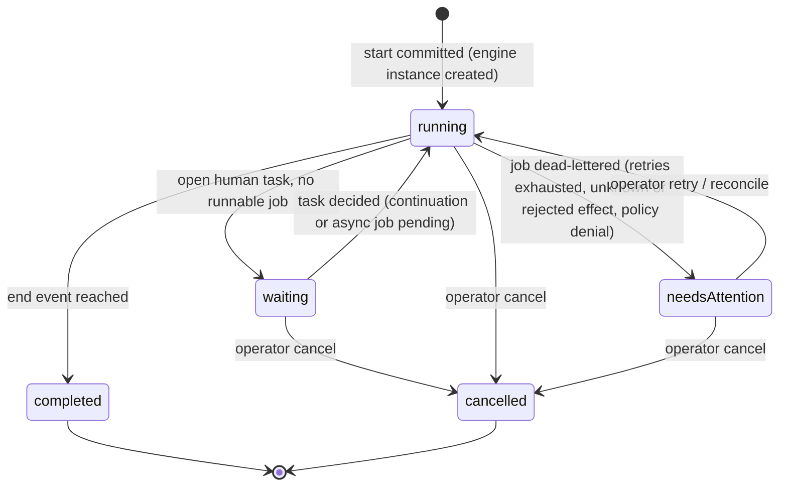
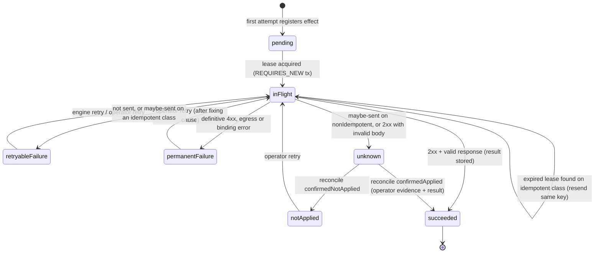

# S2 — Data model and state machines
Build specification · revision 1.0 · 7 October 2026

Authoritative DDL: [`backend/app/src/main/resources/db/migration/V1__orqix_core.sql`](../../backend/app/src/main/resources/db/migration/V1__orqix_core.sql) (executed successfully on PostgreSQL 16.13 during this review, including cross-workspace foreign-key, self-approval, uniqueness and append-only privilege checks). This document explains intent, invariants and state transitions; where the two disagree, fix the disagreement in the same PR.

## 1. Schemas, roles and ownership

| Schema | Owner | Contents | Written by |
|---|---|---|---|
| `orqix` | `orqix_migrator` | Application tables (V1), Spring Session tables (V2) | Flyway in the migration job |
| `flowable` | `orqix_migrator` | Flowable BPMN/DMN engine tables (vendor-managed) | Flowable schema update in the migration job only |

Runtime pods connect as `orqix_app`: DML on `orqix` (minus the append-only revocations) and DML on `flowable`. `orqix_app` never runs DDL. A future retention job uses its own role (R1).

## 2. Tables by responsibility

| Group | Tables | Key invariants |
|---|---|---|
| Tenancy and identity | `organization`, `workspace`, `subject` | `subject` is unique by (issuer, external_subject); email is display data only. `workspace.engine_tenant_id` is the Flowable tenant. Self-approval workflows only in test workspaces (DB check) |
| Access | `role_binding`, `permission_grant`, `workspace_group`, `workspace_group_member` | Role scope must match role kind (DB check). Principals are a subject UUID or an IdP group claim value. Grants in R0: `workflow.start` (workspace-wide or one workflow) and `connection.manage` (workspace-wide) |
| Catalog | `workflow`, `workflow_draft_revision`, `workflow_release`, `release_artifact` | Draft revisions and releases are insert-only. `workflow.draft_revision` is the optimistic lock for drafts; `workflow.version` for active-release changes. Active release must belong to the workflow (composite FK) |
| Integrations | `connection_definition`, `connection_binding` | Definitions are immutable versions. Bindings are per workspace and environment, never exported, and hold a `secret_ref`, never a secret |
| Runtime projections | `workflow_run`, `task_context` | Projections of engine state for search, inbox and display. Updated in the same transaction as the engine change. Flowable remains authoritative for progression |
| Runtime records | `task_decision`, `effect_journal`, `run_event`, `notification` | `task_decision` is one row per engine task (unique). `effect_journal` is one row per effect occurrence. `run_event` has a per-run sequence |
| Cross-cutting | `audit_event`, `idempotency_record` | Audit is append-only for the app role. Idempotency scope is (workspace, principal, operation, key) |

Every child row stores `workspace_id` and references its parent by `(workspace_id, id)`. A bug that tries to attach a run to another workspace's release fails in the database, not only in service code.

## 3. Mutability

| Immutable after insert (app role has no UPDATE/DELETE) | Mutable |
|---|---|
| `workflow_draft_revision`, `workflow_release`, `release_artifact`, `connection_definition`, `task_decision`, `run_event`, `audit_event` | `workflow` (name, draft pointer, active release, version), `workspace_group(+_member)`, `connection_binding`, `workflow_run`, `task_context`, `effect_journal`, `notification.read_at`, `idempotency_record` (completion columns in the creating transaction only) |

Rows referenced by a run or a release are never hard-deleted in R0. Archiving a workflow sets `archived_at`; it remains readable for existing runs.

## 4. Run lifecycle

- The HTTP `201` from start means the run row, the engine instance and the idempotency record committed together. "Accepted" is that response, not a stored state.
- `completed` always carries `outcome` + `outcome_kind` from the reached end node (`Fulfilled`/`success`, `Rejected`/`rejected`). A rejected request is a completed run.
- `needsAttention` always carries `attention` (`reason`, `nodeId`, `effectId`, `message`, `since`). Leaving it clears `attention`.
- `suspended` is R1 (E04); the column check will be extended by migration.

`current_steps` is a JSON array of `{nodeId, label, kind, since, candidateGroup, assigneeId, dueAt}` — one entry per open human task or pending async service task. In R0 graphs it has at most one entry; R1 parallel branches may add more.

Transitions are applied by the runtime module only, at these points (S5 gives the sequences):

| Trigger (same transaction as the engine change) | Projection change |
|---|---|
| Start command after `startProcessInstance` returns | insert run `running`; then listeners below may move it |
| Engine event `TASK_CREATED` (projection listener, S5 §2) | insert `task_context`; add step; lifecycle `waiting` if no async job is pending |
| Engine creates the async job for an http node (projection listener) | add step `{kind: http}`; lifecycle `running` |
| Task decision command | remove step; lifecycle `running` |
| HTTP delegate success | remove step |
| Engine event `PROCESS_COMPLETED` (projection listener) | lifecycle `completed`, outcome from the reached end node, output, `ended_at`, clear steps |
| Failed-job handler, retries = 0 | lifecycle `needsAttention`, set attention |
| Operator retry / reconcile (`confirmedApplied`) | lifecycle `running`, clear attention |
| Operator cancel | lifecycle `cancelled`, `ended_at`, clear steps; open tasks → `cancelled` |

An admin diagnostic (`RunProjectionChecker`, used by tests and the operator runbook) recomputes lifecycle from engine state and reports drift. It never silently rewrites history.

## 5. Task status

`open` → `completed` (decision committed) or `cancelled` (run cancelled). `assignee_subject_id`/`claimed_at` are set by claim and cleared by release; reassignment replaces them. `version` increments on claim, release, reassignment and decision; commands carry `expectedVersion` and fail with `409 TASK_VERSION_CONFLICT` plus a fresh snapshot.

`initiator_subject_id` and `self_approval_allowed` are copied from the run and release when the task is created, so the claimable-task query needs no join to enforce separation of duties.

## 6. Effect journal

- `effect_key` = `sha256(workspaceId | runId | nodeId | occurrence)` hex. `occurrence` is 1 for every node in acyclic R0 graphs; R1 rework/loops allocate a new occurrence per visit.
- `request_hash` = SHA-256 of the canonical (JCS) mapped request body. A retry with a different hash for the same key is a bug and fails as `INTERNAL_ERROR`.
- `result` holds only the mapped result fields (`resultMapping` keys), never the whole response body. `last_error_detail` is redacted (no bodies, headers or credentials).
- An `inFlight` row found at attempt start with an **expired** lease means a previous attempt crashed after possibly sending. For `readOnly`/`idempotentWithKey` the attempt resends with the same key; for `nonIdempotent` it becomes `unknown`. An **unexpired** lease means another executor is active: the attempt aborts as retryable without calling.

## 7. JSON column shapes

| Column | Shape |
|---|---|
| `workflow_run.attention` | `{"reason": "EFFECT_UNKNOWN", "nodeId": "procure", "effectId": "…", "message": "…", "since": "…"}` |
| `workflow_run.input` / `output` | Validated request input / mapped output (`outputMapping`) |
| `workflow_release.manifest` | `ReleaseManifest` schema in OpenAPI |
| `workflow_release.source_map` | `{"nodes": {"manager": ["manager", "manager__route"]}, "transitions": {"t2": ["t2"]}, "bpmnToCanonical": {"manager__route": "manager"}}` |
| `effect_journal.resolution` | `{"kind": "confirmedApplied", "by": "<subjectId>", "at": "…", "note": "…", "remoteReference": "PO-123"}` |
| `task_decision.policy_flags` | e.g. `["selfApprovalAllowed"]` (test workspaces only) |
| `run_event.data` | Per event type, S5 §8; never raw request values beyond the decision outcome and labels |
| `audit_event.metadata` | Whitelisted per action (S6 §7) |

## 8. Query patterns and indexes

| Query | Index |
|---|---|
| My requests (workspace, initiator, newest first, cursor on `created_at,id`) | `workflow_run_ws_initiator` |
| Runs list, optional workflow filter | `workflow_run_ws_created`, `workflow_run_ws_workflow` |
| Runs needing attention | `workflow_run_ws_attention` (partial) |
| Concurrent-run quota (`maxConcurrentRuns`) | `workflow_run_active` (partial) |
| Claimable tasks (group keys of caller, open, unclaimed) | `task_open_claimable` (partial) |
| Assigned tasks | `task_open_assigned` (partial) |
| Completed tasks by me | `task_decision_by_actor` |
| Run timeline polling (`seq > after`) | `run_event` primary key |
| Unread notification count | `notification_unread` (partial) |
| Effects needing review | `effect_needs_review` (partial) |

All list endpoints use keyset pagination on `(created_at DESC, id DESC)` encoded in an opaque cursor; never `OFFSET`.

## 9. Retention in R0

R0 stores everything and runs no purge job; the defaults in [doc 11](../11-security-operations.md) apply from R1 when the data owner approves them (D12). Constraints that must hold from day one: `idempotency_record.expires_at = created_at + 30 days` (expired keys are ignored, not replayed); no business payload in `run_event`, `audit_event` or logs; effect rows are never deleted while `unknown` or `permanentFailure`.

## 10. Migration rules

1. V1 is the reference DDL; V2 is the Spring Session schema copied verbatim from the pinned `spring-session-jdbc` jar.
2. Later changes are new versions only; expand/contract across two releases for anything an old pod still reads.
3. A new append-only table must revoke UPDATE/DELETE from `${app_role}` in the same migration.
4. Engine schema upgrades are rehearsed on a restored copy before production (doc 03).
